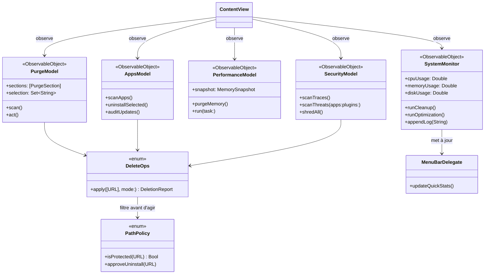

# MonitorMyMac

[](https://www.apple.com/macos/)
[]()
[]()
[]()
[]()
[]()

**MonitorMyMac** est une application **native macOS** qui surveille, nettoie, optimise,
désinstalle et sécurise un Mac — depuis sa barre de menus et une fenêtre SwiftUI organisée en
**quatre espaces de travail**.

> Contrat du projet : mesurer avec les commandes officielles de macOS, afficher le chemin et la
> taille **réels**, laisser l'utilisateur **cocher**, agir de façon **réversible par défaut**,
> et rendre un compte rendu fidèle — échecs et refus compris.
> Aucune donnée ne quitte la machine : aucune classe réseau n'est liée au binaire.

— **Auteur : Martial Zinsou** —

---

## Navigation : quatre espaces, un bandeau, un tiroir

La fenêtre n'aligne plus huit onglets d'un coup. Elle se lit en trois niveaux, et chaque
destination reste à **un clic** de la fenêtre ouverte.

| Niveau | Contenu | Accès |
|---|---|---|
| **Bandeau ambiant** | CPU, RAM, stockage, modèle, système, RAM totale, durée d'activité. Un clic le déplie en jauges complètes : anneaux, courbes d'historique sur 2 min et fiche matériel (page Surveillance). | Toujours visible en tête de fenêtre · `⌘⇧M` |
| **Quatre espaces** | Purge · Performance · Applications · Sécurité, en pastilles « verre liquide » tirées du pack embarqué. | `⌘⇧1` à `⌘⇧4` |
| **Tiroir de documentation** | Aide illustrée, FAQ, À propos. S'ouvre par le « ? » en tête de fenêtre et se referme sur l'espace en cours. | `⌘⇧H` |

| Espace | Ce qu'il fait réellement |
|---|---|
| **Purge** | Sept familles balayées sur le disque, sélection case par case, puis suppression ou mise à la corbeille |
| **Performance** | Purge de la RAM **mesurée avant/après**, processus gourmands, éléments de démarrage, scripts de maintenance |
| **Applications** | Inventaire, désinstallation complète (bundle + résidus), mises à jour centralisées, extensions |
| **Sécurité** | Données de navigation, analyse anti-malware par signatures locales, quarantaine, vérification de signature, broyeur |

| Destination du tiroir | Ce qu'elle montre |
|---|---|
| **Aide illustrée** | Fonctionnement de chaque famille, commandes appelées, limites assumées — captures d'écran à l'appui |
| **FAQ** | Réponses courtes aux questions que le comportement du code pose vraiment |
| **À propos** | Identité, architecture des sources, commandes utilisées, refus de l'application |

Chaque commande de l'interface porte une **info-bulle** qui dit ce qu'elle fait, ce qu'elle ne fait
pas, et quand elle demande une authentification administrateur. Une ligne de guidage, sous les
pastilles, rappelle en une phrase le geste attendu dans l'espace actif.

### 🧹 Nettoyage du stockage (Purge)

| Famille | Portée réelle |
|---|---|
| **Caches utilisateur** | `~/Library/Caches` par application, filtrés par âge (réglable) |
| **Journaux et diagnostics** | `~/Library/Logs`, `/Library/Logs`, `DiagnosticReports`, `CoreSimulator`, `/tmp`, `/var/folders` |
| **Restes de mises à jour** | `SoftwareUpdate`, `Deliverables`, caches de `com.apple.SoftwareUpdate` |
| **Gros fichiers anciens** | Téléchargements, Documents, Bureau + dossiers ajoutés, seuils taille et âge réglables |
| **Doublons** | Regroupement par taille, puis empreinte **SHA-256** partielle (1er et dernier 1 MiB) puis complète |
| **Corbeilles** | Corbeille utilisateur, corbeille Mail (`empty junk mail`), poubelles par volume (invitation administrateur) |
| **Traductions inutilisées** | Repérées et chiffrées, **jamais supprimées** : retirer un `.lproj` casse la signature du bundle |

### 🚀 Optimisation des performances

Libération de la RAM par `purge` (racine via l'invite macOS) avec **gain mesuré**, contrôle des
applications les plus gourmandes en CPU et en énergie (`ps -Aceo …`, `top -o power`), gestion des
éléments de démarrage (`launchctl list/bootout/bootstrap`, plist `.mmm-off` renommés et restaurables)
et neuf scripts de maintenance : permissions du disque, index Spotlight, cache DNS, `mDNSResponder`,
`periodic daily/weekly/monthly`, vidange des diagnostics et plus.

### ⚙️ Applications et extensions

Inventaire des bundles avec taille réelle et version, **désinstallation complète** (bundle +
préférences + résidus `~/Library` au nom de l'identifiant de bundle), mise en quarantaine réversible,
audit des mises à jour (`softwareupdate --list`, `brew outdated`, Mac App Store) **sans rien installer**,
et gestionnaire d'extensions : `pluginkit` (widgets, extensions système), `systemextensionsctl`
et extensions des navigateurs (Chrome, Edge, Brave, Vivaldi, Opera, Safari).

### 🔒 Sécurité et confidentialité

Traces de navigation réelles par navigateur (cookies, historiques, caches, stockage local),
analyse anti-malware par signatures locales + heuristiques + posture système (`csrutil`, `fdesetup`,
`spctl`, `mdutil`), broyeur multi-passes (1 à 7 passes, `FileHandle.write`), et vérification
ciblée `codesign --verify` / `spctl --assess`.

---

## Ce que l'application refuse de faire

Ces limites sont dans le code (`PathPolicy`), pas seulement dans la documentation.

- Ne supprime jamais un élément de `/System`, `/usr`, `/bin`, `/sbin` ou `/private/var/db`.
- Ne supprime pas les traductions `.lproj`.
- Ne touche pas aux signets, mots de passe, trousseaux ni au `places.sqlite` de Firefox.
- N'installe aucune mise à jour et ne télécharge rien.
- Ne promet pas l'irrécupérabilité sur APFS/SSD : **FileVault reste la seule vraie garantie**.
- N'est pas un antivirus certifié et n'a été audité par aucun laboratoire.
- N'envoie aucune télémétrie.

---

## Démarrage rapide

```bash
open MonitorMyMac.app          # lancer l'application
./build.sh                     # recompiler depuis les sources
./build.sh --typecheck         # vérification de typage (rapide, sans binaire)
./build.sh --icons             # régénère le pack d'icônes et AppIcon.icns depuis les planches
./build.sh --shots             # lance l'app et régénère docs/screenshots/*.png
./build.sh --zip               # emballe MonitorMyMac.app.zip et vérifie l'aller-retour
```

L'application démarre en barre de menus **et** ouvre sa fenêtre. Deux menus d'application
exposent les raccourcis suivants (ils ouvrent la destination concernée **et** lancent le travail) :

| Raccourci | Action |
|---|---|
| `⌘⇧1` … `⌘⇧4` | Espace Purge · Performance · Applications · Sécurité |
| `⌘⇧M` | Déplier / replier les jauges de surveillance |
| `⌘⇧H` | Ouvrir / refermer le tiroir Aide · FAQ · À propos |
| `⌘⇧N` | Nettoyage express (temp, caches, logs, corbeille) |
| `⌘⇧O` | Repérer les fichiers volumineux (liste seule, rien n'est supprimé) |
| `⌘⇧P` | Balayage complet de la Purge (7 familles) |
| `⌘⇧R` | Purge de la RAM (authentification administrateur) |
| `⌘⇧A` | Inventaire des applications |
| `⌘⇧X` | Inventaire des extensions |
| `⌘⇧S` | Balayage des données de navigation |

Des options en ligne de commande sont disponibles : `--tab=purge` ouvre directement une destination
(`surveillance`, `purge`, `performance`, `applications`, `securite`, `aide`, `faq`, `apropos`),
`--monitor=expanded` déplie les jauges dès le lancement, `--appearance=dark|light` force le thème
et `--shots=DIR` photographie chaque destination après balayage réel.

Certaines zones (Safari, Mail, `~/Library/Application Support`) protégées par TCC ne sont lisibles
qu'avec l'**Accès complet au disque** (Réglages ▸ Confidentialité et sécurité ▸ Accès complet au
disque). Sans cette autorisation, l'affiche une taille de 0 et la mention « protégé » : elle ne
devine jamais un chiffre.

---

## Structure du projet

```
MonitorMyMac/
├── build.sh                    # compilation Universel 2, assemblage, signature, auto-capture
├── MonitorMyMac.app/           # bundle signé ad hoc (binaire Universel 2 x86_64 + arm64)
│   └── Contents/
│       ├── Info.plist          # métadonnées (version 3.0.0, macOS 11.0+, CFBundleIconFile)
│       ├── MacOS/MonitorMyMac  # binaire compilé (deux tranches assemblées par `lipo`)
│       └── Resources/
│           ├── AppIcon.icns    # icône de l'application (10 tailles, master 1 024 px)
│           ├── Icons/          # 41 tuiles « Liquid Glass » (visuels de marque)
│           └── Screenshots/    # captures embarquées (page Aide illustrée)
├── assets/                     # visuels régénérables, jamais édités à la main
│   ├── icon-sheets/            # les 2 planches JPEG d'origine (2 752 × 1 536), archivées
│   ├── icons/                  # 41 glyphes détourés en PNG transparents + extraction.json
│   │   └── tuiles/             # les mêmes posés sur leur squircle graphite
│   └── appicon/                # AppIcon.iconset (10 PNG), AppIcon.icns, appicon.json
├── tools/                      # la chaîne des icônes et ses sondes
│   ├── extract_icons.py        # planches → glyphes détourés → tuiles
│   ├── make_app_icon.py        # tuile → AppIcon.iconset → AppIcon.icns (`iconutil`)
│   ├── probe_brand_icons.swift # vérifie que le bundle assemblé contient bien le pack
│   ├── list_symbol_names.py    # la liste des noms de SF Symbols du projet (109)
│   └── probe_sf_symbols.swift  # NSImage(systemSymbolName:) sur chacun, sans repli
├── src/
│   ├── MonitorMyMacApp.swift   # SystemMonitor, barre de menus, ContentView, point d'entrée
│   ├── Core/                   # moteurs sans interface
│   │   ├── MMUtility.swift     # Shell, Fmt, PathPolicy, Walker, DeleteOps, Hash, Quarantine
│   │   ├── PurgeEngine.swift   # les 7 balayages de stockage
│   │   ├── PurgeModel.swift    # orchestration « balayer → cocher → agir »
│   │   ├── PerformanceEngine.swift  # mémoire, processus, démarrage, scripts
│   │   ├── PerformanceModel.swift
│   │   ├── AppManagerEngine.swift   # bundles, résidus, mises à jour, extensions
│   │   ├── AppsModel.swift
│   │   ├── SecurityEngine.swift     # traces, signatures, posture, broyeur
│   │   └── SecurityModel.swift
│   ├── UI/                     # vues SwiftUI
│   │   ├── MMTheme.swift       # thème, cartes, pastilles, art de marque, captures
│   │   ├── PurgeView.swift  PerformanceView.swift  AppsView.swift  SecurityView.swift
│   │   ├── DocsViews.swift     # Aide illustrée, FAQ, À propos (tiroir)
│   │   └── ShotCapture.swift   # destinations, état global, mode --shots et thème forcé
│   └── monitormymac.sh         # ancien outil terminal (conservé, indépendant)
├── docs/                       # GUIDE.md, DOCUMENTATION.md, screenshots/
└── wiki/                       # Overview, Features, Getting-Started, Screenshots, UML, Author
```

## Prérequis et compatibilité

- **macOS 11.0 (Big Sur) et suivants.** `LSMinimumSystemVersion` et l'empreinte de chargeur
  (`minos`) valent toutes deux `11.0`, et les deux tranches sont compilées avec
  `-target <arch>-apple-macosx11.0` : une API plus récente que la cible fait échouer la
  compilation, elle ne passe pas inaperçue.
- **Binaire Universel 2** : `x86_64` (Intel) et `arm64` (Apple Silicon) assemblés par `lipo`.
  `lipo -info` et `file` sur le bundle livré confirment les deux architectures.
- **Ce qui a réellement été exécuté** : la tranche `x86_64`, sur un MacBookPro11,3 (Intel
  Core i7-4850HQ, 8 cœurs, 16 Go) sous macOS 13.7.8. Balayages, suppressions, captures
  d'écran et mesures de cette page proviennent de cette machine.
- **Ce qui ne l'a pas été** : la tranche `arm64` est compilée sur cette machine Intel par
  compilation croisée, donc **jamais exécutée** ; et aucune machine sous macOS 11, 12, 14 ou
  15 n'a été disponible pour un démarrage réel. La cible 11.0 est garantie par le compilateur
  et par une couche de compatibilité écrite pour elle, pas par un boot sur Big Sur.
- **Comment la cible 11.0 est tenue** : les couleurs `indigo`, `teal`, `cyan`, `mint` et
  `brown` de SwiftUI (macOS 12+) sont remplacées par des teintes équivalentes, le verre vient
  d'`NSVisualEffectView` (présent depuis 10.11) et non de `Material`, la sélection de texte,
  les symboles SF et le riche texte passent par `mmTextSelection()`, `MMSymbol.safe(_:)` et
  `mmParseRichText()`. Une seule interface, rendue identiquement de 11 à 15.
- Pour recompiler : la toolchain Swift des outils en ligne de commande (`xcode-select --install`)
- Aucune dépendance externe, aucun gestionnaire de paquets, aucun compte

---

## Identité visuelle : pack « Liquid Glass » et icône de l'application

Deux planches d'icônes « Liquid Glass » (2 752 × 1 536 px) sont fournies dans
`assets/icon-sheets/`. Elles ne sont jamais lues par l'application : deux scripts
les découpent et les recomposent en ressources autonomes, que `./build.sh --icons`
régénère d'une commande.

| Production | Contenu |
|---|---|
| `assets/icons/` | 41 glyphes détourés en PNG transparents (256 px), fond de planche knocked out par une matte de luminance, libellés imprimés écartés |
| `assets/icons/tuiles/` | Les mêmes posés sur un squircle graphite calculé — dégradé, reflet en biais, liseré de verre — donc lisibles aussi bien sur une carte claire que sombre |
| `assets/appicon/AppIcon.icns` | Icône de l'application, 10 tailles de 16 à 1 024 px, master 1 024 px, glyphe « moniteur système » |
| `Contents/Resources/Icons/` | Les 41 tuiles embarquées, chargées par `MMBrandIcon` |

Le pack entier, tel qu'il sort des scripts, se regarde sans lancer l'app :

| Sur fond clair | Sur fond sombre |
|---|---|
|  |  |

Elles ne servent qu'aux **visuels de marque** : le logo d'en-tête et le badge
d'À propos prennent l'`AppIcon.icns` du bundle — l'image que LaunchServices
résout pour ce bundle — et les quatre espaces portent leur tuile. Les
**icônes fonctionnelles** restent des SF Symbols : un PNG ne se teinte pas et ne
suit pas l'état d'un bouton. Une tuile absente du bundle n'est pas une panne,
`MMBrandIcon` redessine la pastille en vecteur ; ce repli a été exécuté sur une
copie privée de ses images.

Ce qui est mesuré et ce qui ne l'est pas : `tools/probe_brand_icons.swift`
contrôle les six ressources attendues dans le bundle assemblé et rend l'icône
telle que **LaunchServices** la résout — la source que consulte le Dock ; le
Dock de la machine de développement étant masqué, ce n'est pas lui qui a été
photographié. Le glyphe employé mesure 213 × 176 px sur la planche, donc le
master 1 024 px est un agrandissement ×3,12 : le gabarit est net à toute taille,
le fourré de l'image est doux en très grand.

---

## Captures d'écran

Toutes les images ci-dessous sont produites **par l'application elle-même** sur la machine de
l'auteur (`./build.sh --shots`, capture AppKit du contenu réel de la fenêtre), avec des données réelles.

### Surveillance


### Purge — les sept familles


### Performance — RAM, processus, démarrage, maintenance


### Applications — inventaire, désinstallation, mises à jour, extensions


### Sécurité — navigation, menaces, quarantaine, broyeur


### Aide illustrée


### FAQ


### À propos


### Architecture (aperçu UML)



> Diagrammes UML complets (classes, séquence, états, cas d'utilisation) :
> voir [wiki/UML-Diagrams.md](wiki/UML-Diagrams.md) et la
> [documentation technique](docs/DOCUMENTATION.md).

---

## Documentation

- [Guide utilisateur illustré](docs/GUIDE.md) — comment utiliser chaque espace au quotidien
- [Documentation technique](docs/DOCUMENTATION.md) — architecture, moteurs, politiques de sécurité
- [Wiki du projet](wiki/Overview.md) — vue d'ensemble, fonctionnalités, démarrage, captures, UML, auteur

---

## Licence

Distribué sous licence MIT. Voir le fichier `LICENSE` pour plus d'informations.

## Auteur

**Martial Zinsou** — Développeur et auteur de MonitorMyMac.
