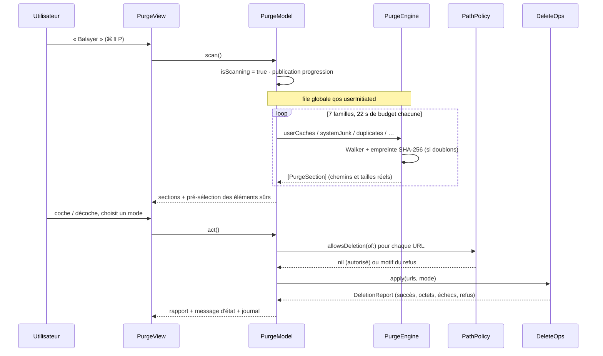

# Documentation technique — MonitorMyMac 3.0

Application native macOS en **Swift 5.8 / SwiftUI + AppKit**, sans framework
tiers, sans paquet, sans réseau. Compilée avec la toolchain en ligne de
commande (aucun projet Xcode n'est nécessaire), **ciblée macOS 11.0** et assemblée
en **binaire Universel 2** (`x86_64` + `arm64`).

> 👤 **Auteur : Martial Zinsou** · Licence MIT · cible macOS 11.0 (Big Sur) et suivants, Universel 2
>
> Compilée pour `x86_64` **et** `arm64` ; seule la tranche `x86_64` a été exécutée,
> sur un MacBookPro11,3 (Intel i7-4850HQ, 16 Go) sous macOS 13.7.8. La tranche
> `arm64`, produite par compilation croisée sur cette machine Intel, n'a jamais été
> exécutée ici, et aucune machine sous macOS 11 n'a été disponible pour un démarrage
> réel. Voir § 6.2.

---

## 1. Architecture

### 1.1 Trois couches, une règle

```
┌──────────────────────────────────────────────────────────────────────┐
│  src/UI/            Vues SwiftUI                                     │
│   MMTheme · PurgeView · PerformanceView · AppsView · SecurityView    │
│   DocsViews (Aide / FAQ / À propos) · ShotCapture (destinations + captures) │
│   → n'affichent QUE ce que les modèles leur donnent.                │
├──────────────────────────────────────────────────────────────────────┤
│  src/Core/*Model    Modèles observables (singletons)                 │
│   PurgeModel · PerformanceModel · AppsModel · SecurityModel          │
│   + SystemMonitor (métriques, journal, nettoyage express)            │
│   → orchestrent « balayer → cocher → agir → rendre compte ».        │
├──────────────────────────────────────────────────────────────────────┤
│  src/Core/*Engine   Moteurs sans interface                           │
│   MMUtility · PurgeEngine · PerformanceEngine                        │
│   AppManagerEngine · SecurityEngine                                  │
│   → parlent au système (commandes officielles, API Foundation).     │
└──────────────────────────────────────────────────────────────────────┘
```

La règle qui tient tout l'édifice : **une vue ne mesure rien**. Elle lit des
propriétés publiées. Inversement, un moteur ne décide rien pour l'utilisateur :
il propose des enregistrements que l'utilisateur coche.

### 1.1bis Inventaire des fichiers

| Fichier | Rôle | Contenu principal |
|---|---|---|
| `src/MonitorMyMacApp.swift` | Coque | `SystemMonitor`, `CPU`/`Memory`/`Disk`/`Device`, `Cleaner`, `Reminder`, `MenuBarDelegate`, `ContentView`, `GaugeCard`/`DiskCard`/`SystemCard`/`HistoryChartCard`, `ReminderCard`, point d'entrée `@main` |
| `src/Core/MMUtility.swift` | Socle | `Shell`, `ShellOutcome`, `Fmt`, `PathPolicy`, `FileRecord`, `Walker`, `DeletionMode`, `DeletionReport`, `DeleteOps`, `Hash`, `Quarantine`, `StatLine`, `PrivacyAccess` |
| `src/Core/PurgeEngine.swift` | Stockage | `PurgeSection`, `PurgeSettings`, `PurgeEngine` (7 balayages) |
| `src/Core/PurgeModel.swift` | Stockage | orchestration, sélection, application, corbeilles Mail/volumes |
| `src/Core/PerformanceEngine.swift` | Performance | `MemorySnapshot`, `ProcessEntry`, `AppConsumption`, `ProcessProbe`, `LoginItem`, `StartupManager`, `MaintenanceTask`, `MaintenanceScripts` |
| `src/Core/PerformanceModel.swift` | Performance | purge RAM mesurée, bascule démarrage, exécution des scripts, fermeture d'applications |
| `src/Core/AppManagerEngine.swift` | Applications | `ManagedApp`, `AppsScanner`, `ResidualScanner`, `AvailableUpdate`, `UpdateAudit`, `UpdateProber`, `PluginEntry`, `BrowserExtension`, `ExtensionManager` |
| `src/Core/AppsModel.swift` | Applications | inventaire, désinstallation + résidus, quarantaine, extensions |
| `src/Core/SecurityEngine.swift` | Sécurité | `BrowserTrace`, `BrowserTraceGroup`, `BrowserData`, `ThreatSeverity`, `ThreatFinding`, `SecurityScanner`, `ShredOutcome`, `FileShredder` |
| `src/Core/SecurityModel.swift` | Sécurité | traces, menaces, posture, quarantaine, broyeur |
| `src/UI/MMTheme.swift` | Design | `Theme`, `Card`, `SectionCard`, `Pill`, `StatChip`, `HonestyNotes`, `StatusLine`, `ModeSelector`, `RecordRow`, `ReportCard`, `ToolButton`, `AppScreenshot`, `GlassBackground`, `MSGlassIcon`, `MMBrandArt`, `MMBrandIcon`, la palette `mm*`, `MMSymbol`, `mmParseRichText` |
| `src/UI/PurgeView.swift` | UI | espace Purge + `PurgeSectionCard` |
| `src/UI/PerformanceView.swift` | UI | espace Performance (4 cartes) |
| `src/UI/AppsView.swift` | UI | espace Applications (4 cartes + `BrowserGroup`) |
| `src/UI/SecurityView.swift` | UI | espace Sécurité (5 cartes) |
| `src/UI/DocsViews.swift` | UI | Aide illustrée (5 sujets), FAQ (13 entrées), À propos, `AppInfo` |
| `src/UI/ShotCapture.swift` | UI | `AppTab` (8 destinations, dont `spaces` et `docs`), `AppState`, `WindowResolver`, `ShotCapture` |

Les 17 fichiers ci-dessus sont les seuls compilés dans le produit. Le dépôt
contient aussi un outillage, hors binaire :

| Outil | Rôle | Utilisé par |
|---|---|---|
| `build.sh` | Compilation des deux tranches, assemblage du bundle, ressources, captures, archive | `--typecheck`, `--icons`, `--shots`, `--zip`, `--clean` |
| `tools/extract_icons.py` | Planches → glyphes détourés → 41 tuiles (§ 3.2.1) | `./build.sh --icons` |
| `tools/make_app_icon.py` | Tuile → `AppIcon.iconset` → `AppIcon.icns` (§ 3.2.1) | `./build.sh --icons` |
| `tools/probe_brand_icons.swift` | Vérifie que le bundle assemblé contient le pack et que LaunchServices résout l'icône | contrôle manuel (§ 6.1) |
| `tools/list_symbol_names.py` | Produit la liste des 109 noms de SF Symbols du projet, avec une règle écrite (§ 6.4) | contrôle manuel |
| `tools/probe_sf_symbols.swift` | Sonde `NSImage(systemSymbolName:)` sur chaque nom, sans logique de repli | contrôle manuel (§ 6.4) |

### 1.2 Flux d'exécution type (Purge)



### 1.3 Modèle de concurrence

C'est le point le plus sensible de l'application, et il a coûté un plantage
réel (voir § 6.3).

1. **Aucune commande système sur le fil principal.** `SystemMonitor.refreshMetrics()`
   et `refreshDeviceInfo()`, ainsi que `runCleanup()` / `runOptimization()`,
   envoient le travail sur `DispatchQueue.global(qos:)` et ne reviennent sur le
   fil principal que pour publier des valeurs.
2. **`Shell.run` ne relance pas la boucle d'événements.** `Process.waitUntilExit()`
   pompe les événements quand il est appelé depuis le fil principal : une vue
   peut alors être reconstruite, toucher un singleton `static let` en cours
   d'initialisation, et `dispatch_once` détecte la reentrée en le piégeant
   (`EXC_BAD_INSTRUCTION`). `Shell.run` utilise donc `terminationHandler` +
   `DispatchSemaphore`, avec un délai borné (`timeout + 5 s`) puis
   `terminate()` si le processus survit.
3. **Un singleton ne mesure rien à sa création.** Les propriétés publiées ont
   des valeurs par défaut vides (`MemorySnapshot.empty`, `[]`,
   `UpdateAudit()`), jamais un appel système.
4. **Les balayages sont bornés dans le temps.** Chaque moteur reçoit une
   `deadline` ; `Walker` l'observe pendant la descente et s'arrête proprement,
   en conservant ce qu'il a déjà mesuré.
5. **Publication sur le fil principal.** Tout `@Published` est mis à jour dans
   un `DispatchQueue.main.async`.

### 1.4 Politique de sécurité (`PathPolicy`)

La politique est évaluée **au moment de l'action**, pas seulement à
l'affichage — une arborescence peut avoir changé entre les deux.

| Règle | Implémentation |
|---|---|
| Zones interdites | `deniedPrefixes` : `/System`, `/usr`, `/bin`, `/sbin`, `/etc`, `/private/etc`, `/private/var/db`, `/private/var/root`, `/Volumes`, `/Library`, `/Applications`, `/opt`, `/private/var/vm`, `/private/var/log`, `/private/tmp` |
| Données personnelles irremplaçables | `deniedHomeSubpaths` : `Library/Mail`, `Keychains`, `Messages`, `Calendars`, `Contacts`, `MobileSync`, `CloudDocs`, `Health`, `HomeKit`, `Passbook`, `AddressBook`, `com.apple.loginitems.plist`… |
| Paquets non traversés | `packageExtensions` : `app`, `framework`, `photoslibrary`, `kext`, `xpc`, `keychain`, `note`, `pages`… + `.skipsPackageDescendants` |
| Exceptions limitées | `allowedOutsideHome` : `/private/tmp`, `/var/folders`, `/tmp` |
| Désinstallation d'un bundle | `approveUninstall(url)` pour la durée de l'opération, puis `revokeUninstallApprovals()` : `/Applications` n'est jamais supprimable sans confirmation explicite |
| Zones TCC | `isTCCProtected(_:)` + `canRead(_:)` : test d'accès réel ; illisible ⇒ annoncé protégé, taille 0, jamais devinée |
| Données utilisateur | `isUserData(_:)` : Documents, Downloads, Desktop, Pictures, Music, Movies — autorisées mais marquées « à vérifier », donc non pré-cochées |

Un refus produit une **ligne dans le rapport** avec son motif exact, jamais une
silencieuse abstention.

### 1.5 Modes de suppression (`DeletionMode`)

| Mode | API | Réversible |
|---|---|---|
| `.trash` (défaut) | `FileManager.trashItem(at:resultingItemURL:)` | oui (corbeille) |
| `.direct` | `FileManager.removeItem` | non |
| `.quarantine` | déplacement vers `~/Library/Application Support/MonitorMyMac/Quarantine` + manifeste JSON (chemin d'origine, horodatage) | oui (bouton « Restaurer ») |

`DeleteOps.apply(_:mode:)` renvoie un `DeletionReport` : octets rendus mesurés,
liste des succès, liste des échecs avec l'erreur de macOS, liste des refus.

**Le nettoyage express (`⌘⇧N`) obéit à la même règle.** Ses trois premières
collectes — `/tmp` au-delà de 60 min, caches utilisateur au-delà de 2 h, journaux
système au-delà de 24 h — passent par `FileManager.trashItem` et sont donc
réversibles ; seule la quatrième, le vidage de la corbeille, est définitive. Le
journal distingue les deux verbes (`placé(s) à la corbeille` /
`définitivement supprimé(s)`) pour qu'aucune des deux ne se lise comme l'autre.
Un fichier possédé par root (`/private/var/log`, une partie de `/tmp`) est refusé
par macOS : il est compté comme conservé, jamais comme supprimé.

> Cet état corrige une incohérence relevée pendant la refonte : `Cleaner.delete(…)`
> appelait `removeItem`, alors que tout le reste de l'application va à la corbeille
> par défaut. Le libellé « réversible » n'était donc pas faux pour l'espace Purge,
> mais il l'était pour le raccourci ⌘⇧N.

---

## 2. Les moteurs

### 2.1 `MMUtility` — le socle

- **`Shell.run(_:_:timeout:)`** — `Process` + deux `Pipe` lus par
  `readabilityHandler` (le tampon ne se bloque jamais), garde-fou temps réel,
  sortie brute conservée. `Shell.runWithAdmin` passe par
  `osascript … with administrator privileges` : la fenêtre de mot de passe est
  celle de macOS, l'app ne stocke rien, une annulation est un résultat remonté.
- **`Walker`** — descente avec deadline, taille **allouée**
  (`totalFileAllocatedSize`) et non logique, `autoreleasepool` par dossier,
  production de `FileRecord` identifiés par empreinte stable.
- **`Hash`** — SHA-256 (CryptoKit) partiel (1ᵉʳ et dernier 1 MiB) puis complet,
  lectures par blocs via `FileHandle`.
- **`Fmt`** — tailles (`0 octet` plutôt que le « Zéro ko » de
  `ByteCountFormatter`), dates, pourcentages, chemins abrégés.
- **`Quarantine`** — déplacement réversible, manifeste, restauration, purge.
- **`PrivacyAccess`** — détection de l'Accès complet au disque et ouverture des
  Réglages concernés.

### 2.2 `PurgeEngine` — sept balayages

| Fonction | Sources réelles |
|---|---|
| `userCaches(days:deadline:)` | `~/Library/Caches` par application |
| `systemJunk(days:deadline:)` | `~/Library/Logs`, `/Library/Logs`, `DiagnosticReports`, `CoreSimulator`, `/tmp`, `/var/folders` |
| `updateLeftovers(deadline:)` | `~/Library/Software Update`, `Deliverables`, paquets périmés |
| `largeAndOldFiles(sizeMB:ageDays:extraFolders:deadline:)` | Downloads/Documents/Desktop + dossiers ajoutés |
| `duplicates(minSizeMB:extraFolders:deadline:)` | groupement par taille → SHA-256 partiel → SHA-256 complet |
| `trashLocations(deadline:)` | `~/.Trash`, corbeilles par volume, courrier indésirable de Mail |
| `unusedTranslations(deadline:)` | `.lproj` absents des langues préférées — **rapport seul** |

### 2.3 `PerformanceEngine`

- `MemorySnapshot.read()` — `vm_stat` + `sysctl` (`hw.memsize`, `vm.swapusage`).
- `ProcessProbe.topConsumers(limit:)` — `ps -Aceo pid,user,pcpu,pmem,rss,comm -r`,
  `energyByPid()` — `top -o power` ; `groupedByApplication` produit des
  `AppConsumption` (les auxiliaires d'une même app sont regroupés).
- `StartupManager` — `launchctl list`, plist des trois domaines, désactivation
  par renommage `.mmm-off` + `bootout`, réactivation par `bootstrap`.
- `MaintenanceScripts.tasks()` — neuf tâches déclaratives (commande exacte,
  explication, besoin d'administration, icône).

### 2.4 `AppManagerEngine`

- `AppsScanner` — domaines utilisateur/local/système, `CFBundle*`, taille réelle,
  exécution via `NSWorkspace`, et `app(at:)` pour l'analyse ciblée.
- `ResidualScanner` — résidus au nom de l'identifiant de bundle dans neuf
  emplacements de `~/Library`, avec mise à l'écart des dossiers partagés éditeur.
- `UpdateProber` — `softwareupdate --list` (version 13.7 : ni `--json` ni
  `--format`), `brew outdated` si Homebrew est présent, App Store par
  `receipt`/`appStoreApps`.
- `ExtensionManager` — `pluginkit -m -A -v` et ses trois états
  (`use`/`ignore`/`invalidate`), `systemextensionsctl list`, manifestes des
  navigateurs Chromium et Safari, ouverture de la page de gestion.

### 2.5 `SecurityEngine`

- `BrowserData.traces(deadline:)` — caches, cookies, historiques, stockage local
  et téléchargements de Safari, Chrome, Edge, Brave, Firefox, Opera, Vivaldi.
  `places.sqlite` de Firefox est **exclu** (il contient les signets).
- `SecurityScanner.scan(apps:plugins:deadline:)` — signatures locales de
  malwares macOS, heuristiques (agents orphelins, binaires en dossiers
  utilisateur, scripts cachés) et posture (`csrutil`, `fdesetup`, `spctl`,
  `mdutil`, `codesign`). Constats pondérés par sévérité, avec preuve et conseil.
- `SecurityScanner.assess(_:)` — `codesign --verify --deep --strict` +
  `spctl --assess --type exec` sur un bundle choisi.
- `FileShredder.shred(_:passes:)` — écrasement sur place (aléatoire puis
  zéros), 1 à 7 passes, vérification de la taille, puis suppression du lien ;
  `supportsBSDSecureDelete()` teste la disponibilité réelle de `rm -P`.

---

## 3. Interface

### 3.1 Structure d'une fenêtre

```
ZStack
├── LinearGradient (fond adaptatif clair/sombre)
└── VStack
    ├── header        : logo (MMBrandIcon → icône réelle du bundle), titre, ? (bascule le tiroir), ↻
    ├── statusStrip   : bandeau ambiant — 3 StripMetric + fiche matériel + chevron
    ├── spaceSelector : 4 pastilles (Purge · Performance · Applications · Sécurité)
    │                 + ligne de guidage propre à l'espace actif
    ├── docsDrawer    : Aide illustrée · FAQ · À propos (rendu si docsOpen)
    ├── content       : ScrollView { jauges dépliées ; espace ; logPanel }
    └── footer        : statut + version (AppInfo.version)
    .frame(minWidth: 760, minHeight: 620)
    .background(WindowResolver())   → résout la NSWindow pour les menus
```

La page **Surveillance** n'est plus un onglet : ses mesures tiennent dans le
bandeau ambiant, et son contenu complet (anneaux, courbes, fiche matériel) se
glisse au-dessus de l'espace actif quand `AppState.monitorExpanded` est vrai.
Atteindre une destination coûte donc un clic depuis la fenêtre ouverte, quel que
soit l'endroit où l'on se trouve.

`AppState.shared` (singleton observable) porte l'espace courant, l'état du tiroir
(`docsOpen`) et celui du bandeau (`monitorExpanded`) : les menus AppKit de la
barre d'état et les commandes SwiftUI peuvent donc naviguer dans l'interface sans
passer par un binding.

### 3.2 Thème et couche de compatibilité macOS 11

`Theme.gradient(_:)`, `Card`, `SectionCard(title:subtitle:systemImage:accent:trailing:)`,
`Pill`, `StatChip`, `HonestyNotes` (notes en markdown léger), `StatusLine`,
`ModeSelector`, `RecordRow`, `ReportCard`, `ToolButton`, `SpacePill`,
`StripMetric`, `MSGlassIcon` et `MMBrandIcon`.

Le rendu ne doit **rien** à une version particulière de macOS. La règle retenue
est « uniforme d'abord, enrichi ensuite » : une seule interface, dessinée avec
des briques disponibles depuis macOS 11, plutôt que huit variantes gardées par
`@available`. Concrètement (`src/UI/MMTheme.swift`) :

| Ce que SwiftUI 12+ offrirait | Ce que l'app utilise à la place |
|---|---|
| `Color.indigo`, `.teal`, `.cyan`, `.mint`, `.brown` | `Color.mmIndigo`, `.mmTeal`, `.mmCyan`, `.mmMint`, `.mmBrown` — des `Color(NSColor.systemX)` disponibles dès macOS 11 et donc dynamiques (elles se corrigent en mode Sombre), sauf `mmCyan` : `NSColor.systemCyan` est, lui, macOS 12, et aucune couleur système ne rend le service sur Big Sur, d'où une teinte RVB fixe |
| `Material` / `.ultraThinMaterial` comme `ShapeStyle` | `View.mmGlass(cornerRadius:kind:)`, qui superpose un `NSVisualEffectView` (matériaux `.sidebar`, `.headerView`, `.underWindowBackground` — présents depuis 10.11 et adaptés au thème) ; trois qualités, `.card`, `.bar`, `.hero` |
| `.foregroundStyle(_:)`, `.tertiary`, `.quaternary`, `AnyShapeStyle` | `.foregroundColor(_:)` et les couleurs `Color.mmLabel` / `.mmSecondaryLabel` / `.mmTertiaryLabel` / `.mmQuaternaryLabel`, dérivées des `NSColor.labelColor…` |
| `Gauge`, `View.tint`, `.textSelection(.enabled)` | jauges tracées à la main dans `StripMetric`, `mmTextSelection()` (sans effet sur 11) |
| `AttributedString(markdown:)` | `mmParseRichText(_:)` + `MMRichText`, un parseur des motifs `**gras**` et `` `code` `` |
| SF Symbols récents (ressource, pas API : le compilateur ne dit rien) | `MMSymbol.safe(_:)` sonde `NSImage(systemSymbolName:)` à l'exécution et replie sur un glyphe connu de macOS 11 (`gauge`→`speedometer`, `macbook`→`desktopcomputer`…) ; `.mmSafeSymbol` s'applique aux 53 sites d'icônes du projet |

Les **visuels de marque** — logo d'en-tête, quatre pastilles d'espaces, badge
d'À propos — sont dessinés par `MMBrandIcon`, qui pose un PNG du pack « Liquid
Glass » embarqué dans le bundle (`Contents/Resources/Icons/`, plus
`AppIcon.icns` pour le logo). La tuile est auto-suffisante : son fond graphite
et son liseré de verre font qu'elle rend pareil en Clair et en Sombre, sans
avoir à se teinter. `MMBrandArt` tient le chargement (cache verrouillé, trois
candidats d'emplacement) et le relevé des absences ; si la ressource manque,
`MMBrandIcon` redessine la pastille en vecteur avec `MSGlassIcon` — ce repli a
été photographié sur une copie du bundle amputée de ses images, et le journal de
lancement nomme chaque ressource absente. Les icônes **fonctionnelles** —
boutons, lignes de résultat, menus, tiroir de docs — restent des SF Symbols,
parce qu'une image bitmap ne se teinte pas et ne suit pas l'état d'un contrôle.

### 3.2.1 Chaîne des icônes (des planches au bundle)

Deux JPEG de planches « Liquid Glass » fournis par l'auteur, 2 752 × 1 536 px
chacun, sont à l'origine du pack. Ils sont archivés sous `assets/icon-sheets/`
et ne sont jamais lus à l'exécution : tout passe par deux scripts Python, donc
le pack se régénère d'une commande (`./build.sh --icons`).

| Étape | Script | Ce qui est calculé |
|---|---|---|
| 1. Découpage | `tools/extract_icons.py` | Grille régulière (6 × 4 et 7 × 5), puis par cellule : repérage du glyphe par signature de lignes (le libellé imprimé sous l'icône est distingué par sa **structure** — 5 à 20 traverses continues par ligne contre 1 à 3 pour le verre — et par sa **position**), matte d'alpha déduite de la luminance (`(lum − fond) / (p99 − fond)`, puissance 0,85, filtre médian 3 × 3), décoinage de la couleur avec diviseur plancher à 0,30, et **remplissage des trous** : une zone sombre cerclée par le dessin est close, donc intérieure, donc rendue opaque à 0,94 (sinon l'écran d'un moniteur devient un trou noir). |
| 2. Tuiles | le même script | Le glyphe est posé sur un squircle calculé (dégradé graphite, reflet spéculaire diagonal, liseré de 1,6 px), en couleurs pré-multipliées pour éviter la frange sombre au redimensionnement. 41 tuiles de 256 px. |
| 3. Icône d'app | `tools/make_app_icon.py` | Même squircle aux proportions de la grille Apple (81 % du canevas à partir de 64 px, presque 100 % en dessous de 32 px), rendu à 2 × la taille demandée puis réduit, 10 tailles de `icon_16x16.png` à `icon_512x512@2x.png`, assemblées par `iconutil -c icns`. |
| 4. Embarquement | `build.sh` → `install_icons()` | Copie de `AppIcon.icns` et des 41 tuiles dans le bundle, plus `CFBundleIconFile = AppIcon` dans l'Info.plist. Sans cette clé, LaunchServices cherche un `Assets.car` que ce bundle n'a pas et le Dock garde l'icône générique. |

Trois limites mesurées, à ne pas présenter comme autre chose :

- **Le master de l'icône est un agrandissement.** Le glyphe « moniteur système »
  natif mesure 213 × 176 px dans un carré de 234 px ; le passer à 1 024 px
  demande un facteur ×3,12. Le gabarit, lui, est calculé et net à toute taille.
  `assets/appicon/appicon.json` consigne le coefficient.
- **La matte est déduite de la luminance**, donc une zone du dessin plus sombre
  que le fond de la planche et *non cerclée* reste transparente. Le remplissage
  de trous ne récupère que ce qui est clos ; son mode de défaillance est « aucun
  changement », jamais un aplat.
- **`ImageGen` n'est pas utilisable ici** : le service a répondu `HTTP 403`
  (`{"code":"112","pricingUrl":…}`) à trois reprises dans cette session. C'est
  parce que les planches viennent du fournisseur que le pack existe malgré tout.

Contrôles réels derrière ces lignes : `python3 tools/extract_icons.py --contact`
écrit deux grilles de contrôle (sur `rgb(236,236,240)` et `rgb(28,28,30)`) et le
journal `assets/icons/extraction.json` — 41 extractions, 0 échec, couverture
opaque moyenne 51,7 % (min 23,6, max 73,1). `tools/probe_brand_icons.swift`
sonde le bundle assemblé avec les mêmes clés que `MMBrandArt` et rend le verdict
« pack de marque complet » ; il écrit aussi l'icône que **LaunchServices**
résout pour le bundle, qui est exactement celle du Dock, du ⌘-Tab et du Finder —
le Dock de cette machine étant masqué, c'est par là qu'on le vérifie, sans
toucher au réglage de l'utilisateur.

### 3.3 Mode capture (`--shots`)

```bash
./build.sh --shots            # docs/screenshots/01…08.png
./MonitorMyMac.app/Contents/MacOS/MonitorMyMac --shots=/tmp/shots --tab=purge
./MonitorMyMac.app/Contents/MacOS/MonitorMyMac --shots=… --appearance=dark
./MonitorMyMac.app/Contents/MacOS/MonitorMyMac --shots=… --monitor=expanded
```

`ShotCapture.run(in:)` impose une taille de fenêtre (1320 × 880), applique
l'apparence demandée à `NSApp.appearance` — le mode sombre se vérifie ainsi sans
toucher aux Réglages système —, puis pour chacune des huit destinations : il
bascule `AppState.tab`, **lance les vrais balayages** du modèle concerné, attend
leur fin réelle (sondage de 0,5 s avec budget par destination : 170 s pour la
Purge, 110 s pour la Sécurité…), laisse SwiftUI poser le rendu, puis photographie
`window.contentView` avec `bitmapImageRepForCachingDisplay(in:)` +
`cacheDisplay(in:to:)` et écrit un PNG. L'application se quitte ensuite.

`ImageRenderer` n'est pas utilisable avec le SDK 13.3 : la capture AppKit est
la voie réelle. Les PNG obtenus sont embarqués par `build.sh` dans
`Contents/Resources/Screenshots` et lus par `AppScreenshot` (avec repli honnête
« capture non embarquée » quand le fichier manque).

---

## 4. Compilation et bundle

```bash
./build.sh                 # compile les deux tranches, assemble, signe
./build.sh --typecheck     # typage complet sans production de binaire (~9 s par passe)
./build.sh --run           # construit puis ouvre l'app
./build.sh --shots         # construit puis régénère les captures
./build.sh --zip           # MonitorMyMac.app.zip + contrôle aller-retour de la signature
./build.sh --clean         # supprime les artefacts
```

La commande équivalente, pour **une** tranche, sans le script :

```bash
swiftc -parse-as-library -O \
  -target x86_64-apple-macosx11.0 \
  src/MonitorMyMacApp.swift src/Core/*.swift src/UI/*.swift \
  -framework SwiftUI -framework AppKit -framework UserNotifications \
  -o build/MonitorMyMac-x86_64
```

Étapes notables du script :

1. `DEPLOY_MIN="11.0"` et `ARCHS=(x86_64 arm64)` : chaque tranche est compilée avec
   `-target <arch>-apple-macosx11.0`. C'est ce réglage — et lui seul — qui fait
   échouer la compilation si une API plus récente que la cible apparaît quelque
   part. `--typecheck` rejoue la même contrainte en mode typage seul, sur les deux
   architectures, pour une vérification rapide.
2. `swiftc -O` sur les 17 fichiers (≈ 80 s par tranche sur un MacBook Pro 2015),
   puis `lipo -create` des deux tranches → binaire Universel 2 de 6,51 Mo
   (6 513 600 octets, mesurés sur le bundle livré ; unités décimales, la convention du Finder
   pour les fichiers).
3. `Info.plist` généré avec la version lue dans `AppInfo.version` (une seule
   source de vérité), `LSMinimumSystemVersion` à **11.0**, `CFBundleIconFile`
   à **AppIcon**, descriptions d'usage AppleScript et volumes amovibles.
4. Copie de `docs/screenshots/*.png` vers `Contents/Resources/Screenshots`,
   de `assets/appicon/AppIcon.icns` vers `Contents/Resources/` et des 41 tuiles
   de `assets/icons/tuiles/` vers `Contents/Resources/Icons/` (`install_icons()`).
   Le script avertit — sans échouer — si l'un manque, puisque l'interface retombe
   alors sur ses pastilles vectorielles ; `./build.sh --icons` régénère le pack.
5. Nettoyage des attributs étendus (`xattr -cr`) **avant** signature : macOS
   refuse de signer un bundle portant du « detritus » (`.DS_Store`,
   `com.apple.FinderInfo`).
6. `codesign --force --sign -` (ad hoc). Sans notarisation : au premier
   lancement depuis le Finder, clic droit → **Ouvrir**.

Contrôles automatiques après assemblage, et ce qu'ils établissent vraiment :

| Contrôle | Sortie mesurée | Ce qu'il prouve |
|---|---|---|
| `lipo -info` | `x86_64 arm64` | les deux tranches sont présentes |
| `file` | `Mach-O universal binary with 2 architectures` | l'assemblage est valide |
| `otool -l` (par tranche) | `minos 11.0`, `sdk 13.3` | le chargeur refuse un démarrage sous macOS 11 ; les deux tranches portent la même cible |
| `codesign --verify --deep --strict` | « satisfies its Designated Requirement » | la signature est intacte |
| `spctl -a -t exec` | **`rejected`** | le bundle n'est pas notarisé : Gatekeeper le bloque au premier lancement, d'où le clic droit → Ouvrir |

---

## 5. Étendre l'application

### Ajouter une famille à la Purge

1. Une fonction dans `PurgeEngine` qui prend une `deadline` et renvoie une
   `PurgeSection` (`id`, `title`, `risk`, `executable`, enregistrements).
2. Une entrée dans la table `steps` de `PurgeModel.scan()`.
3. Rien à faire dans la vue : `PurgeSectionCard` affiche la section, et la
   pré-sélection respecte `risk` (`executable && risk != .caution`).

### Ajouter une tâche de maintenance

Un seul élément dans le tableau de `MaintenanceScripts.tasks()` :
`id`, `title`, `explanation`, `command`, `needsAdmin`, `systemImage`. La carte
de l'espace Performance, le bouton « Tout exécuter » et le journal suivent
automatiquement.

### Ajouter une destination

Un cas dans `AppTab` (`title`, `shortTitle`, `icon`, `accent`, `helpText`,
`guidance`, `shotName`), une branche dans `ContentView.spaceContent`, un cas dans
`ShotCapture.prime` et `isBusy` pour que la capture attende la fin des balayages.

Il faut ensuite dire dans quel niveau la destination vit, car la fenêtre n'a plus
une liste plate d'onglets : `AppTab.spaces` pour paraître en pastille dans le
sélecteur, ou `AppTab.docs` pour loger dans le tiroir « ? ». Une destination qui
n'appartient à aucun des deux reste atteignable par `--tab=` et par le menu de la
barre d'état, mais plus par la fenêtre elle-même.

Si la destination ajoute des commandes, prévoir les `CommandMenu` correspondants
(⌘⇧1…4 sont pris par les quatre espaces) et n'oublier aucun des deux menus :
`@ViewBuilder` s'arrête à dix enfants, et un onzième se signale par une erreur de
typage, pas par un element muet.

---

## 6. Vérifications réelles et incidentes

### 6.1 Ce qui a été vérifié sur la machine de développement

Machine : MacBookPro11,3 — Intel Core i7-4850HQ, 8 cœurs, 16 Go, macOS 13.7.8,
écran 2560 × 1600. Toolchain : Swift 5.8.1 (swiftlang-5.8.0.124.5), SDK macOS 13.3,
sans Xcode.

| Vérification | Résultat mesuré |
|---|---|
| Typage complet du module (17 fichiers), SDK par défaut | 0 erreur, 0 avertissement |
| Typage sous `-target x86_64-apple-macosx11.0` | 0 erreur |
| Typage sous `-target arm64-apple-macosx11.0` | 0 erreur |
| Compilation `-O` des deux tranches | binaire Universel 2 de 6,51 Mo (6 513 600 o ; ≈ 190 s les deux tranches) |
| `lipo -info` / `file` | `x86_64 arm64` — `Mach-O universal binary with 2 architectures` |
| `otool -l`, tranche par tranche | `minos 11.0`, `sdk 13.3`, `platform 1` sur **chacune** des deux tranches |
| `codesign --verify --deep --strict` | « satisfies its Designated Requirement » |
| Lancement réel (`open MonitorMyMac.app`) | fenêtre + icône de barre de menus, titre « MonitorMyMac », mesures cohérentes avec `top`/`vm_stat`/`df` |
| Passe complète de captures, thème clair | 8 PNG, balayages réels (dernière passe, 23:01 : Purge 7 familles en 70 s, 12,14 Go signalés, 35,9 Mo sélectionnés sur 120 éléments) |
| Passe complète de captures, thème sombre (`--appearance=dark`) | 8 PNG, même contenu, rendu vérifié image par image (23:03) |
| Valeurs lues sur le bandeau ambiant | CPU 57-69 % (0 % sur la toute première capture, prise avant le premier relevé), RAM 69 % soit 11,0 Go sur 16,0 Go (« En attente… » au même premier instant), stockage 5 % (21 Go utilisés / 954 Go disponibles), « 8 cœurs · Intel(R) Core(TM) i7-4850HQ CPU @ 2.30GHz », « macOS 13.7.8 · 16 Go » |
| Inventaire des applications | 73 applications, 11,72 Go au total |
| Balayage des données de navigation | 41 traces, 13,8 Mo ; Google Chrome 253,1 Mo ; bannière signalant le navigateur ouvert et ses bases verrouillées |
| Sondage des SF Symbols | 109 noms distincts (`tools/list_symbol_names.py` : 57 littéraux en position d'icône + 50 clés + 46 valeurs de la table de repli), passés au vrai `NSImage(systemSymbolName:)` dans un exécutable AppKit distinct : **101 présents, 8 absents** sur macOS 13.7. Les huit absents sont des clés, donc des troncs là pour être remplacés. Un neuvième nom absent avait été trouvé dans la table, c'était une **valeur** fautive (`box`), corrigée, avec un filet sur le tronc dans `resolve(_:)` pour que le cas ne revienne pas (§ 6.4) |
| Embarquement des ressources | 8 PNG dans `Contents/Resources/Screenshots/`, 41 tuiles dans `Contents/Resources/Icons/`, `AppIcon.icns` (950 593 o, master 1 024 px lu par `sips`) |
| Sondage des visuels de marque (`tools/probe_brand_icons.swift`) | 6/6 ressources résolues dans le bundle assemblé (`AppIcon` 10 tailles, 5 tuiles 256 px), `CFBundleIconFile = AppIcon`, verdict « pack de marque complet » |
| Icône résolue par LaunchServices | `NSWorkspace.icon(forFile:)` sur le bundle rend le glyphe « moniteur » et non l'icône générique — c'est l'image que cherchent le Dock, ⌘-Tab et le Finder |
| Repli sans ressources (test réel) | Copie du bundle amputée de `Icons/` et d'`AppIcon.icns`, relancée en mode capture : aucune case vide, aucun plantage, les pastilles et le logo sont redessinés en vecteur (`MSGlassIcon`) |
| Extraction du pack | 41 glyphes détourés, 0 échec, couverture opaque moyenne 51,7 % (min 23,6, max 73,1), 17 s |
| Contrôle aller-retour de l'archive | `MonitorMyMac.app.zip` (7,51 Mo — 7 511 359 o) extrait, `codesign --verify` valide |

### 6.2 Ce qui n'a **pas** pu être vérifié

- **Démarrage sous macOS 11, 12, 14 ou 15** : aucune machine correspondante n'a
  été disponible. La cible 11.0 est établie par le compilateur (les deux tranches
  refusent toute API plus récente, et `--typecheck` rejoue la contrainte) et par
  l'empreinte `minos 11.0` du chargeur, **pas** par un amorçage réel sur Big Sur.
- **Tranche `arm64`** : produite par compilation croisée sur cette machine Intel,
  elle n'a **jamais été exécutée**. Son typage passe, son assemblage est validé
  par `lipo` et `otool`, son comportement sur Apple Silicon reste non observé.
- **`spctl -a -t exec`** renvoie `rejected` : le bundle est signé ad hoc, non
  notarisé. C'est une limite assumée du distribution locale, pas un défaut de
  signature — `codesign --verify` passe.
- Les actions destructrices (suppression, broyeur, désinstallation) n'ont **pas**
  été exécutées sur de vraies données pendant la rédaction de ces documents :
  un outil de nettoyage ne se teste pas en abîmant la machine de travail. Les
  chemins de code sont exercés par les balayages, pas par les suppressions.
- Les invites d'authentification administrateur (`purge`, corbeilles des
  volumes, `mdutil -E`) n'ont pas été validées par une saisie de mot de passe.
- L'absence de `--json`/`--format` pour `softwareupdate` est une observation de
  macOS 13.7 ; sur d'autres versions, la sortie brute reste affichée telle quelle.
- Les captures ont été produites en 1320 × 880 points (résolution logique) :
  `cacheDisplay` ne rend pas l'échelle Retina.
- Les **info-bulles** ajoutées à chaque commande sont déclarées dans le code
  (`.help` / `.mmHelp`) et typées, mais une bulle ne s'affiche qu'au survol
  réel de la souris : elles n'apparaissent donc dans aucune capture et leur
  rendu visuel n'a pas été photographié.
- Le glyph de repli `trash.slash.fill` du bouton « Broyer » est validé par le
  sondage AppKit (§ 6.4), **pas** par une capture : le bouton est trop bas dans
  la page Sécurité pour tenir dans le cadre 1320 × 880 du mode `--shots`.
- **Le Dock n'a pas été photographié** : il est masqué sur cette machine, et le
  faire apparaître aurait voulu modifier un Réglage de l'utilisateur. L'icône est
  donc vérifiée par `NSWorkspace.icon(forFile:)`, c'est-à-dire par la résolution
  LaunchServices elle-même — la même source que consulte le Dock — et par le logo
  d'en-tête, qui affiche le `AppIcon.icns` du bundle (§ 6.1).
- **L'icône d'application n'est pas un dessin natif 1 024 px** : le glyphe utilisé
  mesure 213 × 176 px sur la planche, et le master 1 024 px l'agrandit ×3,12. Le
  gabarit (squircle, dégradé, liseré) est calculé et net à toute taille ; le
  fourré de l'image est doux en très grand. Les rendus 16 à 64 px, eux, sont bien
  des réductions.
- Une tuile du pack garde un artefact de la planche d'origine : `mots-de-passe`
  montre « 06 » sous la clé, qui ressemble à une numérotation du générateur plutôt
  qu'à un élément du dessin. Elle n'est branchée sur aucune surface de l'app ; la
  corriger demanderait de retoucher le cadre de cette cellule, ce qui toucherait
  aux 41 autres.

### 6.3 Incident : plantage à l'ouverture de Performance

**Symptôme** : `EXC_BAD_INSTRUCTION (SIGILL)` pendant la première passe de
captures, à l'ouverture de la page Performance. **Pile** :
`PerformanceView.init → PerformanceModel.shared.unsafeMutableAddressor →
_dispatch_once_wait.cold.1`.

**Cause** : `Shell.run` attendait la fin du processus avec
`process.waitUntilExit()`. Depuis le fil principal, cette attente **relance la
boucle d'événements** ; SwiftUI a donc reconstruit une vue pendant qu'un
`static let` était en cours d'initialisation sur ce même fil, et `dispatch_once`
a piégé la reentrée. L'initialiseur y contribuait :
`snapshot = MemorySnapshot.read()`, qui exécutait `vm_stat` **pendant** la
création du singleton.

**Correction**, en trois temps :
1. `Shell.run` : `terminationHandler` + `DispatchSemaphore` (aucune pompe à
   événements sur le fil appelant), avec délai borné puis `terminate()`.
2. Valeurs par défaut sans appel système (`MemorySnapshot.empty`).
3. Mesures et nettoyages « express » déplacés hors du fil principal
   (`refreshMetrics`, `refreshDeviceInfo`, `runCleanup`, `runOptimization`),
   avec garde `metricsInFlight` / `deviceInFlight` pour ne pas empiler les relevés.

**Effet de bord mesuré** : avant la correction, l'application consommait un cœur
entier (101 % CPU) à cause de `top` appelé sur le fil principal toutes les
2 secondes, et gelait visiblement. Après, la passe complète de captures s'est
déroulée sans crash ni blocage.

### 6.4 Incident : SF Symbols inexistants

Sept noms utilisés par les vues neuves n'existaient pas sur macOS 13.7
(`gauge.with.dots.needle.50percent`, `arrow.down.circle.dotted`,
`arrow.triangle.counterclockwise`, `lock.open.rectangle`, `shredder.fill`,
`doc.badge.magnifyingglass`, `lock.app.dashed`) : l'icône restait vide à
l'écran. Ils ont été détectés dans le journal de lancement réel, puis un sondage
systématique (`NSImage(systemSymbolName:)` sur les littéraux de symbole du
projet) a confirmé la liste et validé les remplacements :
`gauge.medium`, `arrow.down.circle`, `arrow.counterclockwise`, `lock.open.fill`,
`trash.slash.fill`, `doc.viewfinder`, `lock.rectangle`.

**Ce que le compilateur ne peut pas signaler** : un nom de SF Symbol est une
ressource, pas une API. `-target …-macosx11.0` refuse une fonction trop récente,
mais laisse passer `"shredder"` — l'icône ne manque qu'à l'exécution, et seulement
sur les systèmes plus anciens que celui où l'on compile. D'où `MMSymbol.safe(_:)`,
qui sonde le système une fois par nom, et `.mmSafeSymbol` appliqué aux **53 sites
d'icônes** du projet : un symbole absent retombe sur un équivalent connu de
macOS 11 au lieu de rendre un carré vide.

Le corollaire honnête : ce repli est **sondé sur macOS 13.7**. La liste sondée est
produite par un script, pas par la mémoire de celui qui l'a écrite :
`tools/list_symbol_names.py` retient (1) les littéraux des lignes de `src/` où la
chaîne est à un emplacement d'icône (`systemName:`, `symbol`, `icon`, `tile:`,
`mmSafeSymbol`), (2) les 50 clés de la table de repli de `MMTheme.swift`, (3) ses
46 valeurs — soit **109 noms distincts** (57 littéraux + table). Le fichier d'en-tête
du script explique pourquoi un `grep -rhoE '"[a-z0-9]+(\.[a-z0-9]+)+"' src/`, plus
simple, serait **faux** : il collecte 122 chaînes, parmi lesquelles `com.apple`,
`cookies.sqlite`, `extensions.json`, `hw.pagesize` ou `3.0.0`, qui n'ont jamais été
des noms d'icône.

Ces 109 noms sont passés au vrai `NSImage(systemSymbolName:)` par
`tools/probe_sf_symbols.swift`, exécutable AppKit distinct sans aucune logique de
repli : **101 présents, 8 absents** sur macOS 13.7. Les huit absents (`arrow`,
`bubbles`, `chart`, `hand`, `list`, `macbook`, `shredder`, `text`) sont tous des
**clés** de la table, c'est-à-dire des troncs qu'aucune vue ne demande tels quels :
ils existent précisément pour être remplacés.

Le défaut le plus instructif n'est pas dans cette liste, parce qu'il en est sorti en
étant corrigé : la table déclarait `"shippingbox": "box"`, or `box` n'existe pas dans
les jeux SF Symbols de macOS 13 — c'est une **valeur** de repli absente, ce qu'aucun
sondage des seules clés n'aurait révélé. Concrètement,
`shippingbox.and.arrow.backward.fill` (le bouton « Quarantaine ») — absent sur les
systèmes anciens — remontait la chaîne `clé → box → absent → circle` et rendait un
rond vide précisément sur les machines que la table devait protéger. Deux
corrections, pas une : la valeur est devenue `shippingbox` (premier jeu, même
sens), et `resolve(_:)` tente désormais le **tronc** (`head`) avant le dernier
recours, ce qui rend une valeur de repli erronée incapable de descendre plus bas que
le nom dont elle hérite. Après correction, le modèle de résolution rejoué sur les
mêmes données ne laisse plus finir sur `circle` que `box` — que plus rien ne demande
— et `circle` lui-même.

Le comportement de `MMSymbol.safe(_:)` sur une vraie machine sous macOS 11 reste,
lui, **non observé** (§ 6.2) : le sondage ci-dessus mesure la table sur macOS 13,
pas le système visé.

Le relevé se rejoue en trois commandes :

```bash
swiftc -O tools/probe_sf_symbols.swift -o /tmp/probe -framework AppKit
python3 tools/list_symbol_names.py > /tmp/noms.txt   # 109 noms, règle assumée
/tmp/probe "$(cat /tmp/noms.txt)" | grep ABSENT      # 8 lignes attendues ici
```

Le même contrôle est visible à l'exécution : `applicationDidFinishLaunching`
journalise, 2,5 s après le lancement, soit « aucun SF Symbol absent de ce macOS »,
soit la liste des noms remplacés. **Portée à connaître** : à cet instant seules
les vues déjà rendues ont résolu leurs symboles — bandeau, sélecteur et espace
d'accueil. La ligne « aucun absent » de la capture ne contredit donc pas le
sondage des 109 noms : `shredder`, lui, n'est demandé que par le bouton « Broyer »
de l'espace Sécurité, bien plus bas dans la page. Le contrôle exhaustif reste le
probe des littéraux, pas ce journal ; sans lui, un repli silencieux passerait pour
un rendu normal. Les visuels de marque bitmap, eux, sont sondés **en totalité** au
même moment (`MMBrandArt.manquantes`), parce que la liste attendue est connue
d'avance : le relevé ne dépend donc pas de ce qui était à l'écran.

### 6.5 Incident d'unité : 16 Go ou 17,18 Go pour la même mémoire

En relisant les captures produites, la page **Performance** affichait
« 10,6 Go utilisés sur **17,18 Go** » alors que la page **Surveillance**
affichait « 10,2 Go utilisés sur **16,0 Go** » sur le même Mac de 16 Go.

**Cause** : deux formats différents pour la même quantité.
`Fmt.size` s'appuie sur `ByteCountFormatter` avec `countStyle = .file`, donc
**décimal** (1 Go = 10⁹ o) : 17 179 869 184 o deviennent « 17,18 Go ».
`Fmt.shortSize` divise par 1 073 741 824, donc **binaire** : les mêmes octets
deviennent « 16,0 Go ». Performance utilisait le premier, Surveillance le second.

**Correction** : la RAM est un seul et même objet physique, elle est désormais
rendue en binaire partout (`Fmt.shortSize` dans `PerformanceModel.memoryCardDetail`,
`PerformanceModel.purgeableEstimate` et les cinq `StatChip` de la carte mémoire).
`Fmt.size` reste employé pour les tailles **de fichiers**, où la convention
décimale est celle du Finder. Le correctif a imposé une nouvelle passe complète
de captures, car les PNG publiés doivent montrer le binaire livré.

**Leçon** : la cohérence entre deux pages n'est pas vérifiée par la compilation.
Sans relecture des images, le défaut serait passé pour une simple variation de
mesure instantanée.

### 6.6 Incident d'empaquetage : l'archive ne contenait pas un bundle

`MonitorMyMac.app.zip` était produit par
`ditto -c -k --sequesterRsrc MonitorMyMac.app …`, **sans `--keepParent`**.
L'archive mettait `Contents/` à sa racine : décompressée, elle donnait un dossier
`Contents/` orphelin, ni lançable ni double-cliquable. Le contrôle aller-retour
(extraction dans un dossier temporaire + `codesign --verify` + exécution du
binaire extrait) a été ajouté dans `build.sh --zip` et attrape ce cas.

### 6.7 Comment reproduire les vérifications

```bash
./build.sh --typecheck && ./build.sh          # typage + binaire
./build.sh --shots                            # 8 captures + journal de capture
./build.sh --zip                              # archive + contrôle aller-retour
log show --predicate 'process == "MonitorMyMac"' --last 10m   # journal système
ls -t ~/Library/Logs/DiagnosticReports/MonitorMyMac*          # plantages (doit être vide)

# Cohérence entre les captures publiées et celles embarquées dans le bundle :
for f in docs/screenshots/0*.png; do
  cmp -s "$f" "MonitorMyMac.app/Contents/Resources/Screenshots/$(basename "$f")" \
    && echo "OK   $(basename "$f")" || echo "DIFF $(basename "$f")"
done
```

---

## 7. Outil en ligne de commande (héritage)

`src/monitormymac.sh` est le premier outil terminal du projet (v1.0). Il est
conservé, indépendant de l'application : informations matérielles, CPU, mémoire,
disque, processus et nettoyage simple. Il n'est pas appelé par le binaire.

---

## 8. Design et interface

### 8.1 Style « Liquid Glass »

Le verre vient d'AppKit, pas de `Material` : `NSVisualEffectView` floute le
contenu de la fenêtre depuis macOS 10.11 et s'adapte tout seul au thème. Une
seule implémentation, la même de macOS 11 à 15.

| Zone | Effet |
|---|---|
| Fenêtre | `LinearGradient` adaptatif clair/sombre, fond quasi-transparent |
| Cartes, bandeau, tiroir | `View.mmGlass(cornerRadius:kind:)` → `NSVisualEffectView` (`.underWindowBackground`, `.headerView`, `.sidebar`) sous `RoundedRectangle(cornerRadius:style:.continuous)` et liseré `mmSeparator` ; trois qualités — `.card`, `.bar`, `.hero` |
| Accents | Une couleur par destination, dégradé `Theme.gradient(_:)` sur la pastille active et sur les appels à l'action |
| Icônes de marque | `MMBrandIcon` : PNG du pack « Liquid Glass » embarqué (`Contents/Resources/Icons/`, `AppIcon.icns` pour le logo d'en-tête), tuile auto-suffisante donc identique en Clair et en Sombre ; repli vectoriel `MSGlassIcon` si la ressource manque (§3.2.1) |
| Icônes fonctionnelles | SF Symbols, `isTemplate` pour la barre de menus : seuls eux se teintent et suivent le mode sombre |
| Jauges | `StripMetric` (barre de progression en capsule, seuils 60 % orange / 80 % rouge), `GaugeCard` avec anneau tracé par `Circle().trim(from:to:)` — le `Gauge` SwiftUI, macOS 12+, n'est pas utilisé |
| Mode sombre | Vérifié par `--appearance=dark`, qui force `NSApp.appearance` sans toucher aux Réglages système ; 8 captures sombres en `docs/screenshots/sombre/` |
| Barre de menus | Sparkline en `NSBezierPath` (12 derniers points) + pourcentage CPU |

Le pack bitmap vient des deux planches « Liquid Glass » fournies par l'auteur,
détourées et composées par `tools/extract_icons.py` (41 tuiles) ; l'icône
d'application vient du même glyphe que le logo d'en-tête, assemblée en
`AppIcon.icns` par `tools/make_app_icon.py` (§3.2.1). Le problème d'adaptation
au mode sombre, qui était l'objection de départ contre des PNG, est réglé par la
tuile elle-même : son fond graphite est ce qui rend le verre lisible, il n'a
donc rien à adapter. `ImageGen`, un temps prévu pour fabriquer ces visuels, n'a
pas fonctionné dans cet environnement — `HTTP 403` (`{"code":"112",…}`) à trois
reprises —, ce qui ne bloque rien puisque les planches fournies les contiennent.

### 8.2 Auteur

**Martial Zinsou** — conception, développement, design de l'interface et
documentation. Chaque module a été écrit, compilé et exécuté sur la machine de
l'auteur.

---

[README](../README.md) · [Guide utilisateur](GUIDE.md) ·
[Wiki](../wiki/Overview.md)
