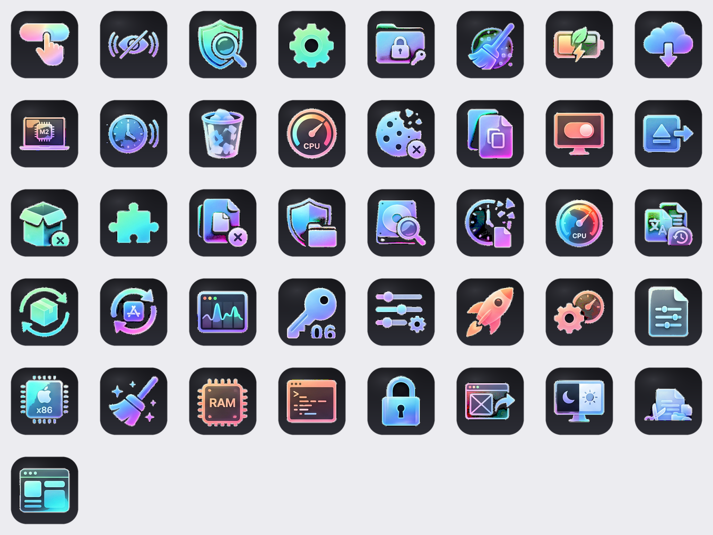
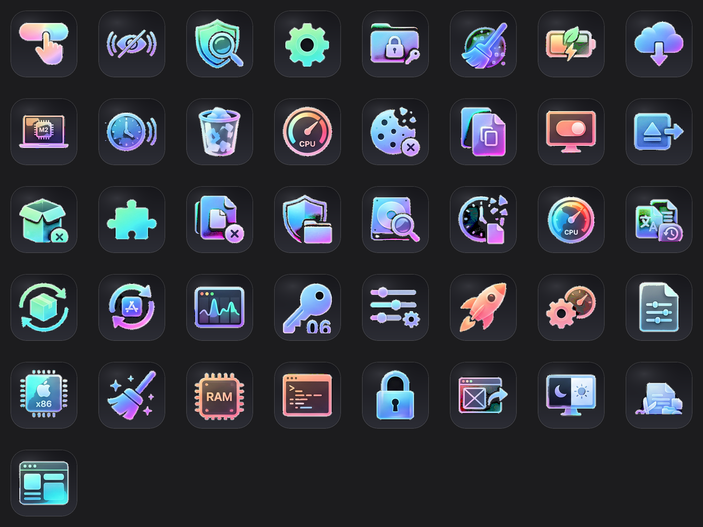

# Guide Utilisateur — MonitorMyMac 3.0

Bienvenue dans **MonitorMyMac**, l'assistant natif de votre Mac : surveillance,
nettoyage du stockage, optimisation des performances, gestion des applications
et des extensions, sécurité et confidentialité.

> 👤 **Auteur : Martial Zinsou** · Licence MIT · macOS 11.0 (Big Sur) et suivants, binaire Universel 2
>
> 🖥️ Toutes les captures de ce guide sont produites **par l'application elle-même**
> (`./build.sh --shots`) sur la machine de l'auteur, avec des données réelles.

---

## 1. Le contrat de l'application

Avant d'utiliser une seule fonctionnalité, il faut connaître la règle du jeu.
MonitorMyMac applique toujours le même enchaînement :

1. **Balayer** — l'app lit le système avec les commandes officielles de macOS
   (`top`, `vm_stat`, `sysctl`, `df`, `ps`, `pluginkit`, `codesign`…).
2. **Montrer** — chaque ligne affiche le **chemin réel**, la **taille réellement
   mesurée** (octets alloués, pas la taille logique) et la date du fichier.
3. **Cocher** — rien n'est sélectionné au hasard : les éléments sûres sont
   pré-cochés, les éléments sensibles restent décochés, et vous pouvez tout
   décocher.
4. **Agir** — par défaut, mise à la **corbeille** (réversible). L'effacement
   direct et le broyeur sont des choix explicites.
5. **Rendre compte** — un rapport final liste les succès, les échecs (avec le
   message d'erreur de macOS) et les **refus** de la politique de sécurité.

Ce que l'app **ne fait jamais** : supprimer un fichier de `/System`, `/usr`,
`/bin`, `/sbin` ou `/private/var/db` ; toucher aux signets, mots de passe ou
trousseaux ; installer une mise à jour ; envoyer la moindre donnée.

---

## 2. Premiers pas

### 2.1 Ouverture

```bash
open MonitorMyMac.app
```

Double-cliquez sur `MonitorMyMac.app` fonctionne aussi. Si macOS bloque
l'ouverture d'une version que vous avez recompilée vous-même : clic droit →
**Ouvrir** → confirmer.

L'application ouvre sa fenêtre **et** dépose une icône dans la barre de menus.
Elle continue de tourner dans cette barre de menus même après fermeture de la
fenêtre : utilisez **Quitter** dans le menu pour l'arrêter.

### 2.2 Quatre espaces, un bandeau, un tiroir

La fenêtre ne présente plus huit onglets de front. Elle organise les mêmes
fonctions en trois niveaux, et chacune reste à un clic.

| Niveau | Contenu |
|---|---|
| **Bandeau ambiant** | CPU, RAM, stockage, modèle, système, RAM totale, durée d'activité — visible en permanence, en tête de chaque espace |
| **Quatre espaces** | **Purge** (récupérer de l'espace, en conscience) · **Performance** (RAM, processus, démarrage, maintenance) · **Applications** (inventaire, désinstallation, mises à jour, extensions) · **Sécurité** (navigation, malwares, quarantaine, broyeur) |
| **Tiroir de documentation** | **Aide illustrée** (comment ça marche, quelles commandes, quelles limites) · **FAQ** (réponses courtes aux vraies questions) · **À propos** (identité, architecture, sources, refus) |

Le bandeau ambiant tient lieu de page **Surveillance** : un clic dessus la déplie
en jauges complètes — anneaux, courbes d'historique sur 2 minutes et fiche
matériel — sans quitter l'espace où vous travaillez.

Le bouton **?** de l'en-tête ouvre ou referme le tiroir ; le bouton **↻**
rafraîchit les mesures. Sous les pastilles, une ligne rappelle en une phrase le
geste attendu dans l'espace actif, et chaque commande porte une info-bulle qui
dit ce qu'elle fait, ce qu'elle ne fait pas, et quand elle réclame une
authentification administrateur. Le journal, en bas de fenêtre, conserve la trace
de toutes les actions de la session.

### 2.3 Accès complet au disque (recommandé)

Safari, Mail et une partie de `~/Library/Application Support` sont protégés par
TCC. Sans autorisation, l'app affiche **0 octet et la mention « protégé »** —
elle ne devine jamais une taille.

> Réglages ▸ Confidentialité et sécurité ▸ **Accès complet au disque** ▸
> activer MonitorMyMac ▸ relancer l'application.

---

## 3. Surveillance 📊


Quatre cartes et deux courbes :

- **Processeur** : pourcentage issu de `top -l 1 -n 0 -s 0`, avec le modèle exact
  du CPU et le nombre de cœurs logiques.
- **Mémoire** : `vm_stat` + `sysctl` — utilisée / totale, avec le détail câblée,
  compressée et échange.
- **Stockage** : `df -h /` — espace utilisé et disponible sur le volume système.
- **Système** : modèle du Mac (`system_profiler`), version de macOS, mémoire
  totale, durée d'activité (`uptime`).
- **Historique** : 60 points, soit environ deux minutes d'échantillonnage à
  raison d'une mesure toutes les deux secondes.

Les mesures sont prises **hors du fil principal** : l'interface ne gèle pas
pendant qu'une commande s'exécute.

---

## 4. Purge 🧹


Cet espace remplace l'ancien « Nettoyage intelligent ». Il balaye **sept
familles**, chacune avec son propre budget de 22 secondes pour ne jamais
bloquer l'interface.

| Famille | Ce qui est cherché | Risque affiché |
|---|---|---|
| **Caches utilisateur** | `~/Library/Caches`, par application, âge réglable | Sûr |
| **Journaux et diagnostics** | `~/Library/Logs`, `/Library/Logs`, `DiagnosticReports`, `/tmp`, `/var/folders` | Sûr |
| **Restes de mises à jour** | `SoftwareUpdate`, `Deliverables`, paquets d'update périmés | Sûr |
| **Gros fichiers anciens** | Téléchargements, Documents, Bureau + dossiers ajoutés, seuils réglables | ⚠️ Données personnelles |
| **Doublons** | Taille identique → SHA-256 partiel (1ᵉʳ et dernier 1 MiB) → SHA-256 complet | ⚠️ Un seul exemplaire à garder |
| **Corbeilles** | Corbeille utilisateur, corbeille Mail, poubelles par volume | ⚠️ Irréversible une fois vidé |
| **Traductions inutilisées** | `.lproj` des langues absentes de vos préférences | 🚫 Repérées, jamais supprimées |

### 4.1 Régler les seuils

Le bouton **Réglages** ouvre les curseurs : âge des caches, âge des journaux,
taille et âge minimaux des gros fichiers, taille minimale des doublons, et la
liste des **dossiers supplémentaires** à analyser. Les réglages sont conservés
d'une session à l'autre.

### 4.2 Choisir, puis agir

Chaque section a ses commandes **Tout** / **Rien**, et chaque ligne est une
case à cocher individuellement. L'en-tête affiche en permanence l'espace
sélectionné, l'espace total signalé et l'espace libéré pendant la session.

Le bloc **Appliquer** propose trois modes :

| Mode | Ce qui se passe |
|---|---|
| **Corbeille** (défaut) | `FileManager.trashItem` : tout est restaurable |
| **Effacement direct** | Suppression sans corbeille — définitif |
| **Quarantaine** | Déplacement vers le dossier de l'app + manifeste JSON |

Le rapport final indique les éléments supprimés, l'espace rendu, les erreurs
rencontrées et les éléments **refusés** par la politique de sécurité.

### 4.3 Corbeilles spécifiques

- **Mail** : le bouton passe par AppleScript (`empty junk mail`), donc par Mail
  lui-même ; les messages sont bien partis, pas seulement masqués.
- **Volumes externes** : `/Volumes/<disque>/.Trashes` appartient à `root`. Le
  bouton dédié ouvre l'invite d'authentification macOS officielle. Annuler
  l'authentification est un résultat acceptable, affiché comme tel.

### 4.4 Rappel hebdomadaire

En bas de l'espace Purge, sous la carte d'action, l'interrupteur programme une notification chaque dimanche à
10 h. Y cliquer lance le nettoyage express.

---

## 5. Performance ⚡


### 5.1 Libérer la RAM

La jauge montre la pression mémoire (active + câblée + compressée / total).
Le bouton **« Purger la RAM »** exécute `/usr/sbin/purge` via l'invite
d'authentification macOS, puis **relit** `vm_stat` : le chiffre affiché est la
différence mesurée avant/après, pas une estimation.

> Réalité du terrain : `purge` ne rend que les pages inactives et le cache
> disque. Les pages câblées (noyau) et compressées restent en place, et macOS
> rend déjà les pages inactives dès qu'une application les réclame. Il est
> normal que le gain soit modeste sur une machine bien dimensionnée.

### 5.2 Applications gourmandes

Les processus sont regroupés par application (`ps -Aceo pid,user,pcpu,pmem,rss,comm -r`)
et triés par CPU cumulé, avec l'énergie mesurée par `top -o power` quand elle
est disponible. Deux niveaux d'action :

- **« Quitter »** sur une application : `terminate()` propre via
  `NSRunningApplication`, puis signaux sur les PID restants de votre session ;
- **« Arrêter »** sur un PID précis — avec un cadenas et la **raison réelle** du
  refus quand le processus appartient à root ou à un autre utilisateur.

### 5.3 Éléments de démarrage

L'app liste les agents et démons déclarés (`launchctl list`, plist de
`~/Library/LaunchAgents`, `/Library/LaunchAgents`, `/Library/LaunchDaemons`).
**Désactiver** renomme le plist en `.mmm-off` et fait `launchctl bootout` ;
**Réactiver** renomme et fait `launchctl bootstrap`. Rien n'est supprimé.

> Sur Ventura et suivants, les éléments « Login Items » gérés par le système ne
> sont pas modifiables depuis une application non installée dans `/Applications` :
> la ligne reste visible, l'action est refusée et le motif est affiché.

### 5.4 Scripts de maintenance

Neuf tâches, chacune documentée (commande exacte, effet, durée possible) :
état et réindexation Spotlight, vérification du volume, réparation des
autorisations, base Launch Services, cache DNS, `mDNSResponder`, tâches
`periodic`, vidange des diagnostics. La sortie **brute** de la commande est
affichée sous chaque exécution, avec un bouton de copie. Les tâches marquées
cadenas passent par l'invite administrateur.

---

## 6. Applications ⚙️


### 6.1 Inventaire

Toutes les applications des domaines utilisateur, local et système, avec taille
réelle, version (`CFBundleShortVersionString`), éditeur, signature et état
d'exécution. Le champ de filtre cherche par nom et par identifiant de bundle.

### 6.2 Désinstallation complète

Cocher une application puis **« Désinstaller »** traite le bundle **et** ses
résidus : préférences (`com.editeur.plist`), `Application Support`, `Caches`,
`Saved Application State`, `Containers`, `Logs`, extensions. L'option
**« Inclure les résidus »** reste visible et décochable.

Deux garde-fous :

- un bundle situé dans `/System/Applications` est marqué système et refusé ;
- un dossier partagé par l'éditeur (`~/Library/Application Support/Google`, par
  exemple) n'est **jamais** supprimé avec une seule application : il reste
  listé pour un contrôle manuel.

**Quarantaine** déplace l'application dans le dossier de l'app avec un manifeste
JSON (chemin d'origine, horodatage) : réversible tant que vous ne videz pas la
quarantaine.

### 6.3 Mises à jour centralisées

`softwareupdate --list` pour les composants Apple, `brew outdated` si Homebrew
est présent, et la liste des applications installées depuis le Mac App Store.
La sortie brute d'`softwareupdate` est affichée telle quelle. **L'application
n'installe rien** : elle vous dit quoi mettre à jour et où le faire.

### 6.4 Extensions

- **Extensions système et widgets** : `pluginkit -m -A -v`, avec Activer
  (`-e use`), Ignorer (`-e ignore`) et Invalider (`-e invalidate`) — et
  `systemextensionsctl list` pour les extensions de niveau système.
- **Extensions de navigateurs** : dossiers d'extensions de Chrome, Edge, Brave,
  Vivaldi et Opera, avec taille et nom. **Retirer de la liste** est désactivé
  tant que le navigateur est ouvert (il réécrirait votre suppression), et la
  **page de gestion officielle** est accessible en un clic.

---

## 7. Sécurité 🔒


### 7.1 Données de navigation

Traces réelles par navigateur (Safari, Chrome, Edge, Brave, Firefox, Opera,
Vivaldi) : cookies, historiques, caches, stockage local, téléchargements. Les
pastilles indiquent le total par navigateur, les cases permettent de choisir
famille par famille.

Trois protections non négociables :

- **Firefox** : son historique vit dans `places.sqlite`, **en même temps que vos
  signets**. L'app épargne ce fichier et propose la page officielle de purge.
- Les **navigateurs ouverts** sont signalés par une bannière : un bouton les
  ferme proprement, et leurs fichiers en cours d'usage ne sont pas supprimés.
- Les **mots de passe et trousseaux** ne sont jamais dans la liste.

### 7.2 Analyse anti-malware

Analyse par **signatures locales** (malwares macOS connus), **heuristiques**
(launch agents orphelins, binaires dans des dossiers utilisateur, scripts de
démarrage cachés) et **posture système** (`csrutil`, `fdesetup`, `spctl`,
`mdutil`). Chaque constat affiche sa sévérité — confirmée, suspecte,
information — sa **preuve** (chemin, sortie de commande) et son conseil.

> Ce n'est **pas un antivirus certifié** : aucun laboratoire n'a audité ces
> signatures. Une absence de résultat ne signifie pas absence de menace.

Par défaut, un élément signalé part en **quarantaine réversible** ; la
suppression directe reste un choix explicite, et la carte Quarantaine permet de
restaurer ou de purger.

### 7.3 Vérification d'une application

Le sélecteur ouvre n'importe quel bundle et rend le verdict de
`codesign --verify --deep --strict` et `spctl --assess`, avec le régime de
Gatekeeper local. `spctl` reflète la **politique locale** : une app refusée peut
être parfaitement légitime (non notarisée) et une app acceptée peut être
malveillante si elle a été infectée après notarisation.

### 7.4 Broyeur de fichiers

Écrasement multi-passes (1 à 7 passes, contenu aléatoire puis zéros), avec
vérification : après écrasement, l'app relit la taille et confirme la
suppression du lien. Glissez-déposez des fichiers ou passez par le sélecteur.

> **Limite assumée** : sur APFS/SSD, le copy-on-write écrit les blocs ailleurs,
> le TRIM et les instantanés « Local Time Machine » peuvent conserver l'ancien
> contenu. L'écrasement reste utile sur disque dur mécanique ; pour des données
> réellement sensibles, la seule garantie robuste est le **chiffrement du
> volume** (FileVault).

---

## 8. Aide, FAQ et À propos ❓


La page **Aide illustrée** explique, famille par famille, le fonctionnement réel : ce qui
est balayé, les **commandes effectivement appelées**, les limites. Chaque
section est illustrée par une capture produite par l'app.


La **FAQ** (13 entrées, filtrables) répond aux questions que le comportement du
code pose vraiment : pourquoi la purge de RAM rend peu, pourquoi les corbeilles
externes demandent un mot de passe, pourquoi les `.lproj` ne partent pas, où va
un fichier « supprimé », comment réactiver un élément de démarrage…


**À propos** donne la version, l'auteur, la licence, la liste des fichiers
sources et de leurs rôles, la liste des commandes système utilisées, la liste
des refus, et les commandes de construction.

---

## 9. Raccourcis clavier

| Raccourci | Action |
|---|---|
| `⌘⇧1` … `⌘⇧4` | Espace Purge · Performance · Applications · Sécurité |
| `⌘⇧M` | Déplier / replier les jauges de surveillance |
| `⌘⇧H` | Ouvrir / refermer le tiroir Aide · FAQ · À propos |
| `⌘⇧N` | Nettoyage express (temp, caches, logs, corbeille) |
| `⌘⇧O` | Repérer les fichiers volumineux (liste seule, rien n'est supprimé) |
| `⌘⇧P` | Balayage complet de la Purge (7 familles) |
| `⌘⇧R` | Purge de la RAM (authentification administrateur) |
| `⌘⇧A` | Inventaire des applications |
| `⌘⇧X` | Inventaire des extensions |
| `⌘⇧S` | Balayage des données de navigation |

Ils sont répartis entre les menus **Actions** et **Navigation**, donc accessibles
quand la fenêtre est visible. Le menu de la barre de menus propose les mêmes
entrées, plus l'accès direct aux quatre espaces, au bandeau déplié et aux trois
pages du tiroir.

Sauf nuance à connaître : les deux actions rapides de ce menu s'affublent de
`⌘N` et `⌘O`, parce qu'un `NSMenuItem` rend toujours son équivalent‑clavier dans
sa colonne de droite. Elles appartiennent au menu du `NSStatusItem`, pas au menu
principal de l'application ; les raccourcis qui agissent sur la fenêtre restent
`⌘⇧N` et `⌘⇧O`. Cliquer l'entrée du menu de la barre d'état, elle, fait exactement
la même chose que le raccourci correspondant.

Le raccourci `⌘⇧O` mérite une précision : la commande **liste** les fichiers de
plus de 100 Mo dans Téléchargements, Documents et Bureau, elle n'en supprime
aucun. L'appeler ne libère donc aucune place — c'est volontaire, et le libellé le
dit maintenant.

---

## 10. Dépannage

| Situation | Explication / solution |
|---|---|
| Une zone affiche « protégé » et 0 octet | TCC : accordez l'Accès complet au disque, puis relancez le balayage |
| Un bouton est grisé avec un cadenas | La politique de sécurité refuse : le motif est écrit à côté du bouton |
| Un effacement échoue | Le rapport affiche l'erreur exacte de macOS (droits, fichier ouvert, volume démonté) |
| La purge de RAM rend peu | Comportement normal, voir FAQ |
| Un navigateur ouvert bloque ses traces | Fermez-le depuis la bannière de l'espace Sécurité |
| La fenêtre ne réapparaît pas | Icône de la barre de menus → **MonitorMyMac**, ou **Ouvrir une section** |
| Le balayage de la Purge est long | Les doublons exigent une empreinte SHA-256 ; chaque famille est limitée à 22 s |
| L'app refuse d'ouvrir (Gatekeeper) | Clic droit → **Ouvrir** ; le bundle est signé ad hoc, pas notarisé |

---

## 11. Interface et style

MonitorMyMac reste 100 % natif : SwiftUI + AppKit, aucun framework tiers.

| Zone | Rendu |
|---|---|
| Cartes | Verre AppKit (`NSVisualEffectView`, matériau `.sidebar`) derrière un `RoundedRectangle(cornerRadius: 18, style: .continuous)` ; `ultraThinMaterial` serait macOS 12 |
| Bandeau et barres | Même verre, matériau `.headerView` ; les surfaces de marque (sélecteur d'espaces, À propos) prennent `.underWindowBackground`, plus présent |
| Accents | Une couleur par famille (bleu, rose, orange, violet, cyan, vert, sarcelle, indigo), via `NSColor.systemX` pour rester dynamique en mode Sombre ; seul le cyan est une teinte RVB fixe, `NSColor.systemCyan` n'existant qu'à partir de macOS 12 |
| Jauges | `PressureBar` et `StripMetric`, dessinées à la main : `Gauge` et son style `accessoryLinearCapacity` exigent macOS 13 |
| Icônes fonctionnelles | SF Symbols passés par `.mmSafeSymbol` : seuls eux se teintent et suivent le mode clair/sombre |
| Pastilles de marque | `MMBrandIcon` pose les tuiles « Liquid Glass » du pack embarqué (`Contents/Resources/Icons/`), et le logo d'en-tête ainsi que le badge d'À propos prennent l'`AppIcon.icns` du bundle — la résolution LaunchServices que consultent le Dock, ⌘‑Tab et le Finder. Réservé aux visuels de marque : sélecteur d'espaces, en-tête, carte d'identité. Si une ressource manque, repli automatique sur `MSGlassIcon`, la pastille vectorielle |
| Barre de menus | Sparkline dessinée à la volée (`NSBezierPath`), image `isTemplate` |
| Texte riche | `mmParseRichText` découpe le markdown ; `AttributedString(markdown:)` est macOS 12 |

### 11.1 D'où viennent les tuiles et l'icône de l'app

Le style « verre liquide » des pastilles n'est pas dessiné à la main dans le
code : il part de deux planches d'icônes « Liquid Glass » (2 752 × 1 536 px
chacune), archivées dans `assets/icon-sheets/`, que deux scripts Python
découpent et recomposent.

```bash
./build.sh --icons      # 41 tuiles dans assets/icons/tuiles/ + assets/appicon/AppIcon.icns
./build.sh              # les copie dans le bundle (Contents/Resources/)
```

`tools/extract_icons.py` isole chaque glyphe de son fond gris très sombre (la
matte est déduite de la luminance, les libellés imprimés sous les icônes sont
écartés par leur structure de ligne), puis le pose sur un squircle graphite
calculé — dégradé, reflet en biais, liseré de verre. Cette tuile est
auto-suffisante, ce qui règle la question du mode sombre : une même image rend
correctement sur une carte claire comme sur une carte sombre. Les deux grilles
ci-dessous sont ce que produit `--contact`, c'est-à-dire le pack entier posé
l'un sur fond clair, l'autre sur fond sombre :

| Clair | Sombre |
|---|---|
|  |  |

`tools/make_app_icon.py` reprend le même squircle aux proportions de la grille
Apple et fabrique les dix tailles d'un `AppIcon.icns` (`iconutil`). Le glyphe
retenu est « moniteur système » : un écran et sa courbe néon. La limite est
dite — ce glyphe mesure 213 × 176 px sur la planche, si bien que le master
1 024 px est un agrandissement ×3,12, même si le gabarit reste net.

L'interface ne dépend de rien de tout cela : sans les PNG, `MMBrandIcon`
redessine les pastilles en vecteur. Ce chemin de repli a été exécuté pour de
vrai sur une copie du bundle privée de ses images.

---

*Auteur : **Martial Zinsou*** · [README](../README.md) ·
[Documentation technique](DOCUMENTATION.md) · [Wiki](../wiki/Overview.md)
