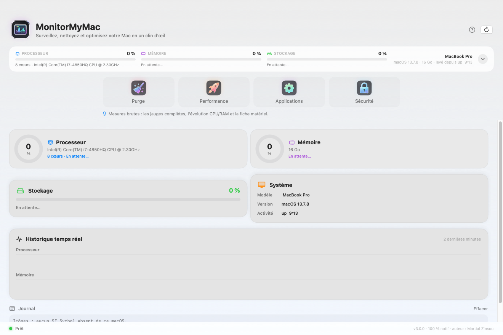
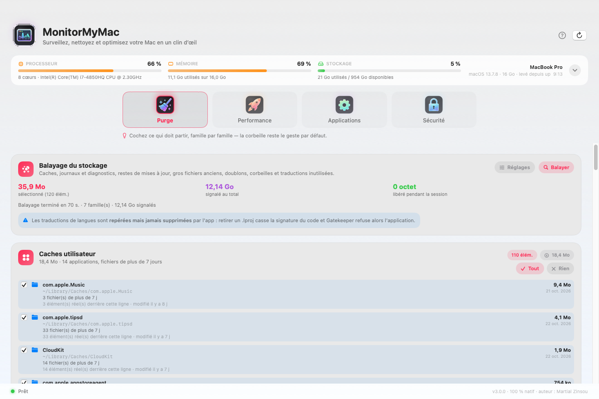
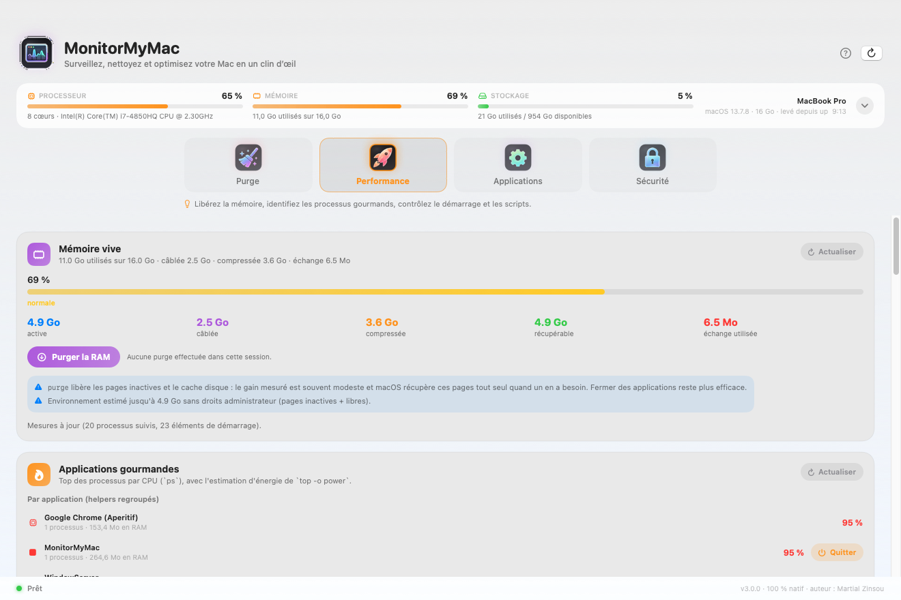
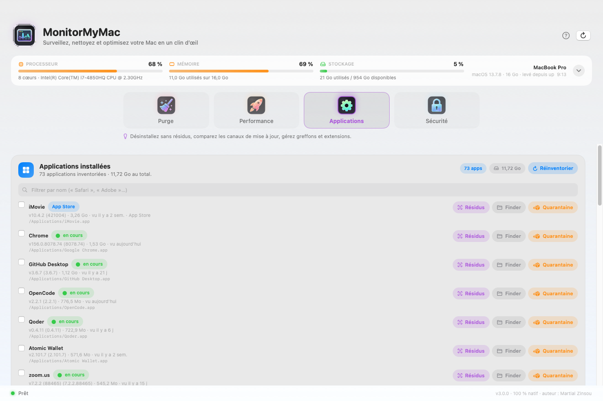
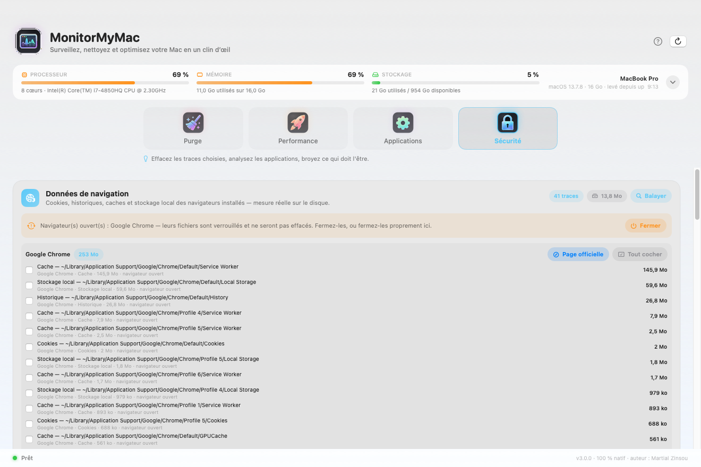
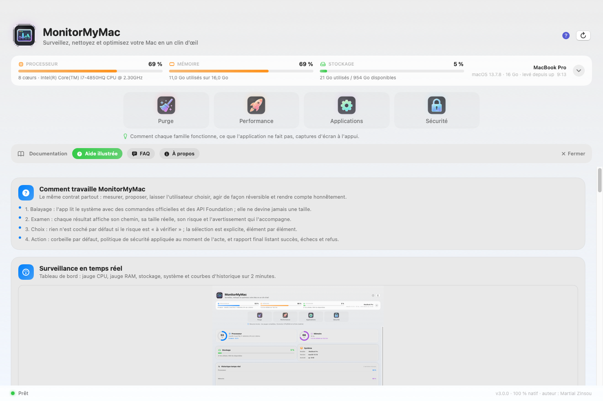
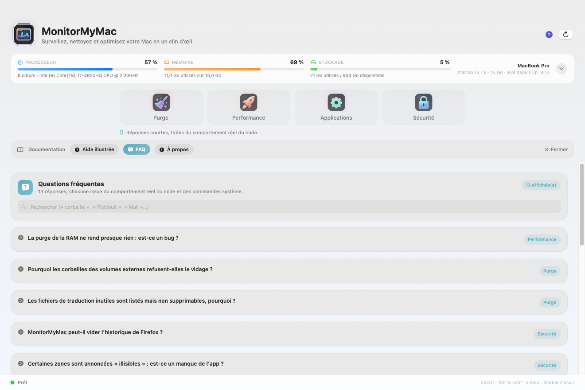
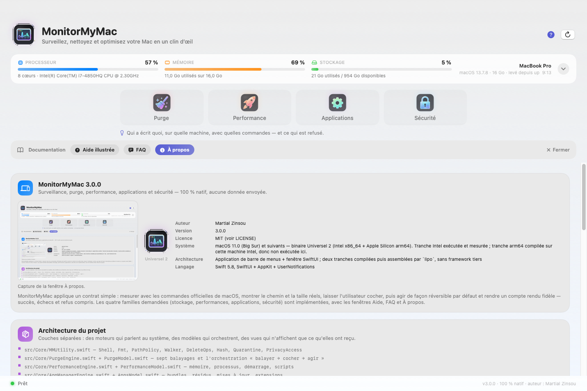
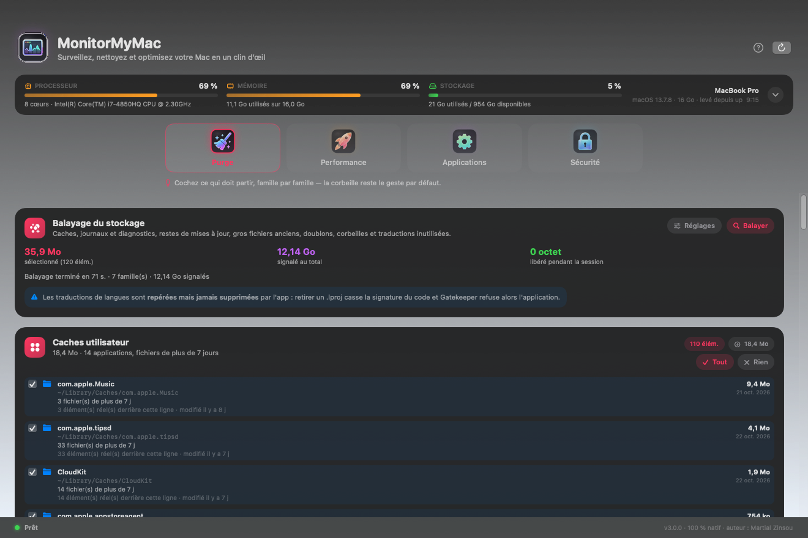
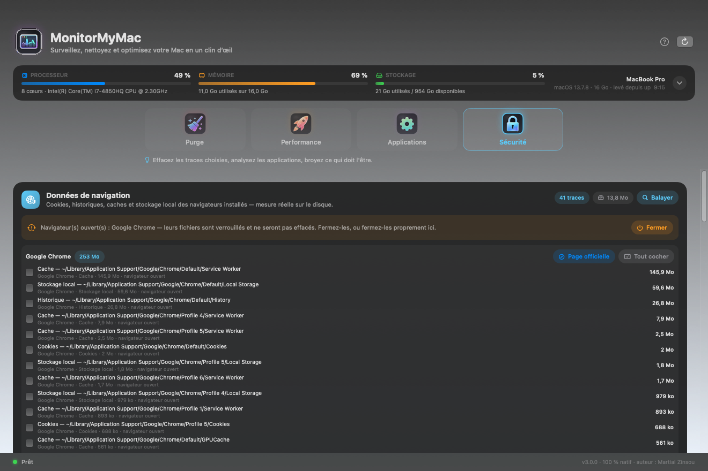

# MonitorMyMac — Galerie de captures d'écran

Les huit captures de cette page sont **authentiques** : elles ont été produites par l'application elle‑même, en une seule exécution, via le mode `--shots` (`src/UI/ShotCapture.swift`). Chaque destination est ouverte, son scan réel est lancé, puis la fenêtre est photographiée avec `bitmapImageRepForCachingDisplay(in:)` + `cacheDisplay(in:to:)` d'AppKit.

Chaque capture existe en **deux thèmes**. Les images de cette page sont la passe claire ; la passe sombre, obtenue avec `--appearance=dark`, est rangée en regard dans [`docs/screenshots/sombre/`](../docs/screenshots/sombre/). Le thème est forcé sur `NSApp.appearance` pendant la session de capture, sans toucher au réglage système de l'utilisateur.

> **Ce qui est vrai / ce qui ne l'est pas.** Les chiffres affichés (CPU, RAM, disques, caches, applications, traces) proviennent des commandes système réelles de la machine de développement. En revanche, le rendu n'est **pas** Retina : la machine testeuse est un MacBook Pro 11,3 non Retina, donc chaque PNG fait exactement **1320 × 880 px**. Aucune capture n'a été maquillée, recadrée ni composée.
>
> Une chose ne se voit pas ici : les **info‑bulles** `.help` portées par chaque commande. Une bulle n'apparaît qu'au survol réel de la souris, donc aucune capture ne peut la montrer.

---

## 01 — Page Surveillance (bandeau déplié)



Le bandeau ambiant, déplié : jauges annulaires **Processeur**, **Mémoire** et **Stockage**, carte **Système** (modèle, version macOS, activité) et carte **Historique temps réel** à deux courbes (bleu = CPU, violet = RAM, 60 points échantillonnés toutes les 2 s). Les mesures viennent de `top -l 1 -n 0 -s 0`, `vm_stat`, `sysctl` et `df -h /`, exécutées **hors du fil principal**.

Dans l'usage courant, ce contenu n'est pas un onglet : il se glisse au‑dessus de l'espace actif d'un simple clic sur le bandeau (ou `⌘⇧M`), sans quitter ce que l'on faisait.

**Dimensions** : 1320 × 880 px · PNG.

---

## 02 — Espace Purge



Balayage réel du stockage : fichiers système inutiles (caches, historiques, restes de mises à jour), fichiers volumineux et anciens, doublons (photos / musiques / documents) et corbeilles (principale, Mail, applications). Chaque famille est une carte avec sa taille mesurée ; rien n'est supprimé sans case cochée. Le bandeau supérieur indique le temps de balayage, le nombre de familles et le volume signalé ; le pied de page indique le volume **sélectionné**. Le rappel hebdomadaire (dimanche 10 h) se règle ici, sous la carte d'action.

La note visible en bas de la première carte — « Les traductions de langues sont **repérées mais jamais supprimées** par l'app » — est un exemple du rendu `**gras**` produit par `mmParseRichText`, le parseur maison qui remplace `AttributedString(markdown:)` (macOS 12+).

**Dimensions** : 1320 × 880 px · PNG.

---

## 03 — Espace Performance



Libération de RAM (lecture `vm_stat`, purge via `sudo purge` demandé par `osascript … with administrator privileges`), éléments de démarrage (`launchctl` / `LoginItems`), scripts de maintenance (réparation des permissions, réindexation Spotlight via `mdutil`) et processus gourmands classés par CPU et par énergie (`top -o power`, `ps -Aceo`).

Le bouton « Tout exécuter » ne porte plus la mention « sans root » : la plupart des tâches qu'il lance passent bel et bien par l'invite d'authentification, et le dire était trompeur.

**Dimensions** : 1320 × 880 px · PNG.

---

## 04 — Espace Applications



Inventaire réel de `/Applications`, `/Applications/Utilities`, `~/Applications`, `~/Downloads` et `/System/Applications` ; désinstallation complète (application + résidus `~/Library` + préférences), audit des mises à jour (`softwareupdate --list`, `brew outdated`) et gestionnaire d'extensions (`pluginkit`, `systemextensionsctl`, extensions de navigateurs).

**Dimensions** : 1320 × 880 px · PNG.

---

## 05 — Espace Sécurité



Données de navigation par navigateur et par nature (cookies, historiques, caches) avec sélection granulaire, analyse anti‑malware (malwares, adwares, espions), contrôle de signatures (`codesign` / `spctl` / `csrutil` / `fdesetup` / `mdutil`) et broyeur de fichiers. Une bannière signale les navigateurs **ouverts**, dont les fichiers sont alors écartés par respect des données vivantes.

Le broyeur écrase le fichier octet par octet sur 1 à 7 passes, le vérifie, le tronçonne à zéro, puis le **détache** avec `removeItem` — jamais à la corbeille : c'est le seul chemin de l'application où l'irréversibilité est l'objet même de la commande. Son info‑bulle le dit, et rappelle qu'aucun broyage ne garantit l'irrécupérabilité sur un SSD chiffré : seul FileVault l'apporte.

**Dimensions** : 1320 × 880 px · PNG.

---

## 06 — Aide illustrée (tiroir)



Aide intégrée : un topic par famille, avec le fonctionnement réel, les limites connues et **une capture d'écran embarquée** depuis `Contents/Resources/Screenshots` (la ressource du bundle, pas un fichier du dépôt). C'est la preuve que l'incorporation des captures au paquet fonctionne.

La capture montre le tiroir ouvert sous le sélecteur d'espaces : les trois pastilles restent inactives, l'espace travaillé n'est pas perdu. La carte « Raccourcis et barre de menus » énumère les dix raccourcis réellement câblés.

**Dimensions** : 1320 × 880 px · PNG.

---

## 07 — FAQ (tiroir)



Questions/réponses couvrant le péché d'origine de chaque fonction : ce qui est supprimé, où, de façon réversible ou non, pourquoi certaines actions demandent un mot de passe administrateur et ce que l'application refuse volontairement de faire. Chaque question se déplie ou se replie sur clic.

**Dimensions** : 1320 × 880 px · PNG.

---

## 08 — À propos (tiroir)



Version, auteur, licence, pile technique, cible système et architecture du binaire, couches d'architecture, table des raccourcis clavier et note d'honnêteté sur ce qui a été réellement testé sur cette machine.

La mention « Système » de la carte d'identité est l'endroit où l'application elle‑même déclare la limite : cible macOS 11.0 et Universel 2, tranche Intel exécutée et mesurée, tranche arm64 compilée mais non exécutée.

**Dimensions** : 1320 × 880 px · PNG.

---

## Le sélecteur d'espaces, en deux thèmes

Les quatre pastilles portent une tuile « Liquid Glass » du pack embarqué, détourée de deux planches fournies (`assets/icons/tuiles/`, régénérables par `./build.sh --icons`) ; le logo d'en-tête et le badge d'À propos prennent l'`AppIcon.icns` du bundle. Elles rendent la même image en clair et en sombre pour une raison simple : la tuile est auto-suffisante, son fond graphite et son liseré de verre font partie du PNG. Les couleurs d'accent, elles, viennent toujours de `NSColor.systemX` (dynamiques) et le verre des cartes d'`NSVisualEffectView`.

| Clair | Sombre |
|---|---|
|  |  |
|  |  |

---

## Barre de menus

L'icône `NSStatusItem` affiche le pourcentage CPU courant et un mini‑sparkline. Son menu propose l'état, CPU/RAM/Disque, « Nettoyage rapide », « Repérer les fichiers volumineux » et un sous‑menu **« Ouvrir une section »** organisé comme la fenêtre : les quatre espaces, le dépliage des jauges, la page Surveillance complète, puis les trois pages de documentation. Cette capture n'est **pas** incluse dans le jeu `--shots` : le mode photographie la fenêtre SwiftUI, pas la barre système. Une capture de la barre de menus exige `screencapture` manuel, ce qui sort du périmètre automatisé.

---

## Archives

Deux jeux plus anciens sont conservés dans le dépôt, à titre historique, et ne doivent **pas** être publiés :

| Emplacement | Contenu | Pourquoi archivé |
|---|---|---|
| `docs/screenshots/_v2_backup/` | 5 PNG de la v2.1 (3 onglets, 1012 × 760) | Interface remplacée par la navigation en quatre espaces de la v3.0. |
| `docs/screenshots/_v2_desktop_backup/` | 5 PNG « Liquid Glass » (2880 × 1800 + 520 × 56) | Captures du **bureau entier**, avec notifications personnelles visibles ; la légende d'origine annonçait de plus un `NSVisualEffectView` `.sidebarItem` qui n'existait pas dans le code de l'époque. |

Ces dix fichiers sont **identiques octet pour octet** à ce que conserve le commit `HEAD` (`docs/screenshots/0?-panel-*.png` et `wiki/screenshots/0?-panel-*-liquid.png`) : ils sont donc récupérables par `git checkout` et ne constituent pas une sauvegarde utile. Ils restent sur le disque parce que leur suppression n'a pas été autorisée.

La phrase d'une version précédente de cette page — « il n'y a pas de `NSVisualEffectView` » — est **fausse aujourd'hui** et a été retirée ici comme ailleurs : le verre des cartes, du bandeau et du tiroir est bien rendu par `NSVisualEffectView` (voir `GlassBackground` et `View.mmGlass` dans `src/UI/MMTheme.swift`), choisi précisément parce que `Material` comme `ShapeStyle` exige macOS 12.

Ce qui reste vrai de l'ancienne légende : les PNG « Liquid Glass » archivés ne montraient pas ce rendu — ils photographiaient le bureau entier. Le style « verre » actuel est celui des captures de cette page, et il vient maintenant de vraies images « Liquid Glass », détourées des planches fournies par l'auteur et composées en tuiles (`tools/extract_icons.py`) ; le rendu vectoriel `MSGlassIcon` n'est plus que le repli, et il n'apparaît dans aucune de ces captures.

---

## Ajouter ou renouveler des captures

Inutile de photographier l'écran à la main : l'application le fait.

```bash
./build.sh                                  # compile et signe
./MonitorMyMac.app/Contents/MacOS/MonitorMyMac --shots=/tmp/shots
./MonitorMyMac.app/Contents/MacOS/MonitorMyMac --shots=/tmp/shots-sombre --appearance=dark
./MonitorMyMac.app/Contents/MacOS/MonitorMyMac --shots=/tmp/shotes --monitor=expanded
```

Le parcours est séquentiel et non bloquant : destination par destination, `AppTab.allCases`, scan réel, attente de la fin du scan (sonde toutes les 0,5 s, budget 20 à 170 s selon la destination), écriture de `01-surveillance.png` … `08-apropos.png`, puis `NSApp.terminate`. Pour une seule destination :

```bash
./MonitorMyMac.app/Contents/MacOS/MonitorMyMac --tab=purge --shots=/tmp/un-seul
```

`--tab=` fixe la destination d'ouverture mais ne restreint pas la passe : le mode `--shots` parcourt toujours les huit destinations. `--appearance=dark|light` (valeurs acceptées aussi en français : `sombre`, `clair`) force le thème de la session.

Ensuite : `cp /tmp/shots/*.png docs/screenshots/ && ./build.sh`, pour que le bundle embarque les nouvelles images dans `Contents/Resources/Screenshots` (lues par la page Aide illustrée).

---
Auteur : **Martial Zinsou**
