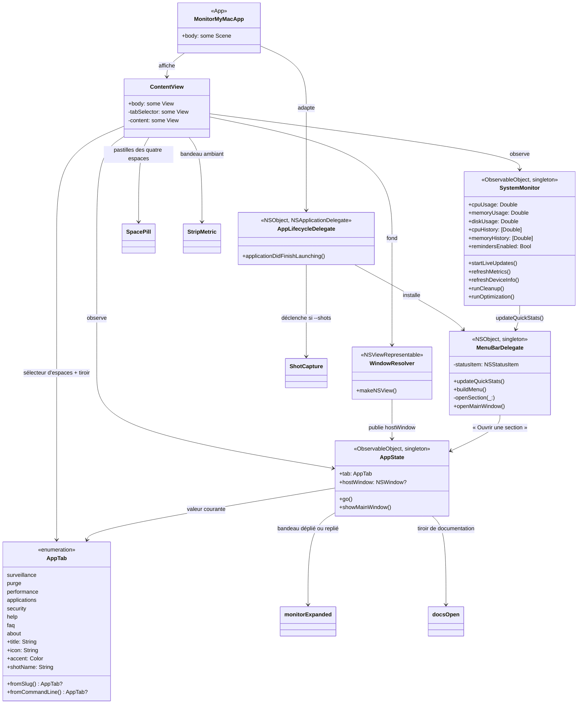
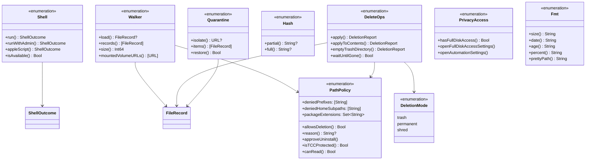
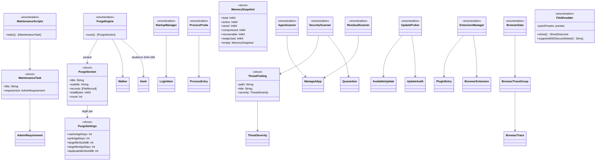
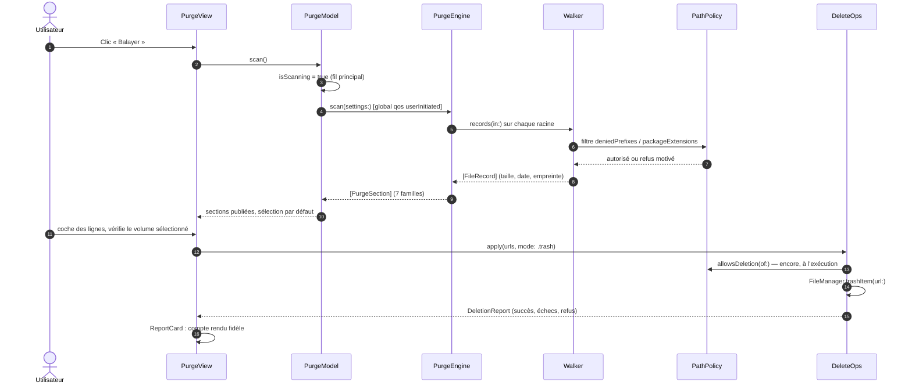
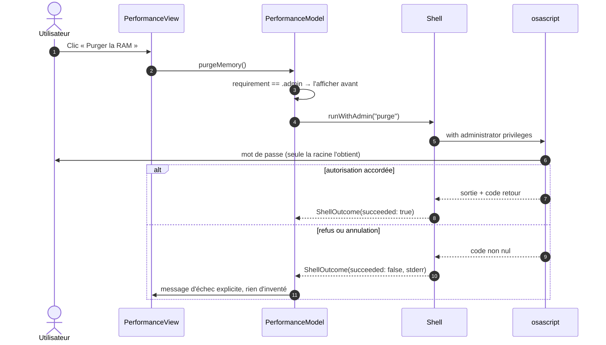
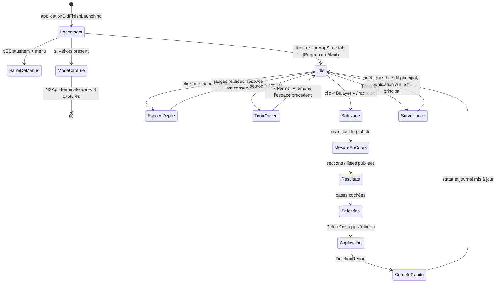
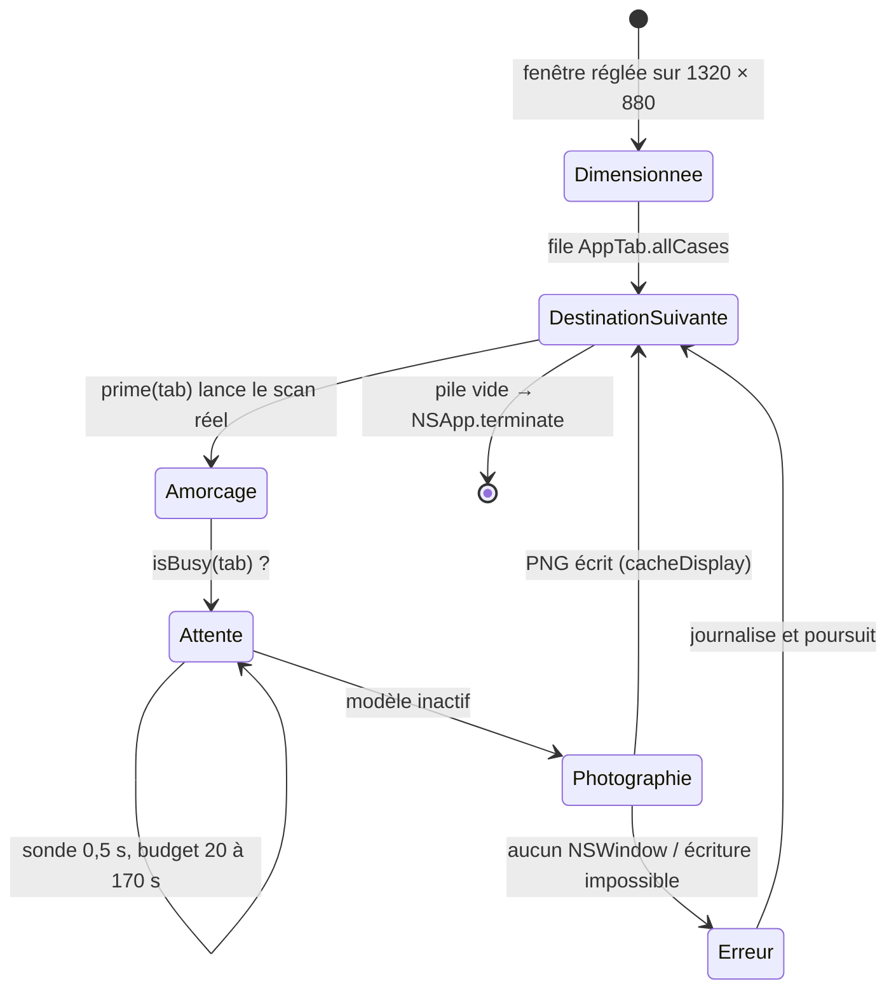
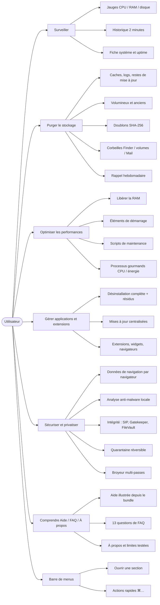
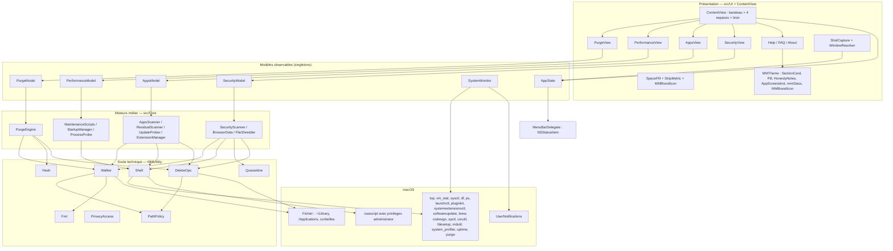
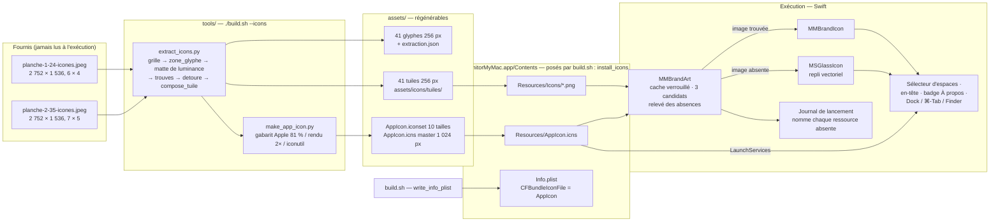

# MonitorMyMac — Diagrammes UML (v3.0.0)

Diagrammes rédigés en **syntaxe Mermaid**, lisibles directement sur GitHub. Ils décrivent le code réellement présent dans `src/` ; chaque nom de classe, de structure ou de méthode correspond à une déclaration existante.

---

## 1. Diagramme de classes — coquille applicative



## 2. Diagramme de classes — destinations et modèles

```mermaid
classDiagram
    class PurgeView
    class PerformanceView
    class AppsView
    class SecurityView
    class HelpTabView
    class FAQTabView
    class AboutTabView

    class PurgeModel {
        <<ObservableObject, singleton>>
        +sections: [PurgeSection]
        +settings: PurgeSettings
        +scan()
        +emptyVolumeTrashesWithAdmin()
        +emptyMailJunk()
    }
    class PerformanceModel {
        <<ObservableObject, singleton>>
        +snapshot: MemorySnapshot
        +loginItems: [LoginItem]
        +processes: [ProcessEntry]
        +refreshAll()
        +purgeMemory()
    }
    class AppsModel {
        <<ObservableObject, singleton>>
        +apps: [ManagedApp]
        +plugins: [PluginEntry]
        +updates: UpdateAudit
        +scanApps()
        +scanExtensions()
        +auditUpdates()
    }
    class SecurityModel {
        <<ObservableObject, singleton>>
        +groups: [BrowserTraceGroup]
        +findings: [ThreatFinding]
        +scanTraces()
        +scanThreats()
    }

    PurgeView --> PurgeModel
    PerformanceView --> PerformanceModel
    AppsView --> AppsModel
    SecurityView --> SecurityModel
    HelpTabView --> AppInfo
    FAQTabView --> AppInfo
    AboutTabView --> AppInfo
    AppsView --> SecurityModel : scanThreats(apps:plugins:)
```

Les huit destinations sont sélectionnées par le même `switch` de `ContentView.spaceContent` (avec `EmptyView()` pour `.surveillance`, dont le contenu est servi par `monitoringGrid`). Quatre d'entre elles — Purge, Performance, Applications, Sécurité — sont des espaces choisis par les pastilles ; trois — Aide, FAQ, À propos — sont des pages de documentation atteintes par le tiroir, qui règle `AppState.docsOpen` en plus de `AppState.tab`. La page Surveillance complète remplace l'espace quand `AppState.monitorExpanded` l'exige.

## 3. Diagramme de classes — moteurs et utilitaires



`PathPolicy` est le **garde‑fou unique** : tout ce qui est supprimé y passe, et un chemin non autorisé produit un refus tracé dans le compte rendu, jamais un silence.

## 4. Diagramme de classes — moteurs métier



## 5. Diagramme de séquence — balayage puis suppression (Purge)



La double vérification par `PathPolicy` (au scan **et** à l'exécution) est volontaire : une liste construite à l'avance ne doit jamais pouvoir convaincre l'app de supprimer un chemin protégé.

## 6. Diagramme de séquence — action privilégiée



## 7. Diagramme d'états — cycle de vie d'une destination



## 8. Diagramme d'états — machine de capture `--shots`



Aucune attente bloquante : `DispatchQueue.main.asyncAfter` enchaîne les états, sinon le `NSRunLoop` se bloque et la capture échoue.

## 9. Diagramme de cas d'utilisation



## 10. Schéma d'architecture en couches



---

## 11. Chaîne des icônes — des planches au Dock

Rien de ce graphe n'est exécuté par l'application : la colonne de gauche est un
pipeline hors-ligne (Python + `iconutil`), celle de droite ce que le bundle
contient et ce que SwiftUI en fait.



Deux arêtes méritent le commentaire. `MMBrandArt → MSGlassIcon` est le chemin de
défaillance : il a été exercé pour de vrai sur une copie du bundle privée de
`Icons/` et d'`AppIcon.icns`, et c'est lui qui rend le pack non obligatoire à la
compilation. `AppIcon.icns → LaunchServices → Dock` est le seul chemin par
lequel l'icône du Dock a été contrôlée ici — le Dock de la machine de
développement est masqué, et `NSWorkspace.icon(forFile:)` consulte exactement la
même résolution.

---
Auteur : **Martial Zinsou**
